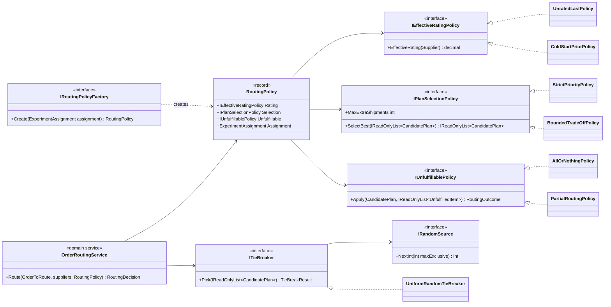
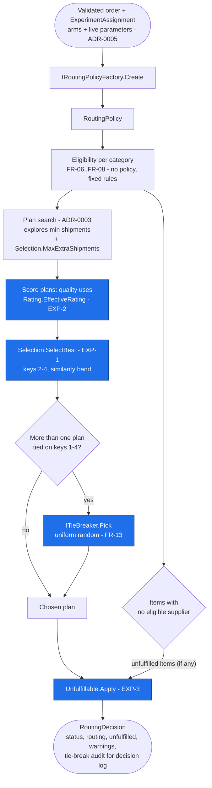

# ADR-0001: Compose routing behaviour from per-experiment policies

| | |
|---|---|
| **Status** | proposed |
| **Deciders** | Architecture (author), Product stakeholder |
| **Date** | 2026-11-15 |
| **Technical Story** | Candidate **C-02** in [Order-Router-Technical-Requirements.md §13](../BusinessRequirements/Order-Router-Technical-Requirements.md#13-candidate-adrs). Requirements: FR-11, FR-13, FR-14, FR-18, AB-03, AB-06, §7.3, §8.1, SC-25 |

## Context and Problem Statement

The router ranks candidate plans with five keys (§7.3): feasibility, fewer shipments, plan quality, local preference within a similarity band, and a random pick on a full tie. The stakeholder chose to **A/B test three policy questions** instead of fixing them (SC-01, SC-02, SC-05):

| Experiment | Control (A) | Treatment (B) |
|---|---|---|
| EXP-1 consolidation vs quality | Strict priority (fewer shipments always wins) | Bounded trade-off (one extra shipment if quality improves by ≥ `quality_uplift_threshold`) |
| EXP-2 unrated suppliers | Unrated ranks below all rated | Cold-start prior (`unrated_prior`) |
| EXP-3 unfulfillable items | All-or-nothing | Partial routing + dependency warnings |

The experiments are independent (each is salted separately, AB-01), so one order can land in any of **2 × 2 × 2 = 8 combinations**. AB-06 requires that adding an arm does not change the routing core.

**How should routing behaviour be structured so that each experiment arm can be swapped independently, the core stays closed for modification, and the full-tie random pick stays testable?**

## Decision Drivers

- **AB-06 / OCP**: a new arm must not change the routing core.
- **Runtime control without deploy** (SC-25): turning an experiment on/off, changing its traffic or targeting, or changing its parameters must take effect on the next request, with no code change or redeploy. Assignment itself is [ADR-0005](ADR-0005-experiment-assignment.md).
- **Independent experiments** (AB-01): the 8 combinations must not become 8 hand-written classes.
- **AB-03**: with everything off, behaviour equals the spec as written (strict, unrated last, all-or-nothing).
- **FR-13 / NFR-08**: randomness only on a full tie, through an injectable `IRandomSource`.
- **"Decouple rules from state"** (CLAUDE.md): policies are separate from eligibility and plan search.
- **Testability**: each arm can be unit-tested on its own; the composition can be tested once.
- **Timebox** (BR-22, NFR-09): treatment arms can be stubbed without touching the core.

## Considered Options

1. **Single router with configuration flags**: one class with `if (exp1Treatment) … else …` branches.
2. **One strategy per full combination**: eight `IRoutingStrategy` implementations, one per A/B combination, chosen by a factory.
3. **Composed policies, one interface per experiment dimension**: each arm implements its dimension's interface. A factory composes one `RoutingPolicy` per request from the assigned arms. The tie-break is a separate collaborator with an injected `IRandomSource`.
4. **External rules engine** (e.g., NRules, or JSON rules evaluated at runtime).

## Decision Outcome

Chosen option: **"3. Composed policies, one interface per experiment dimension"**. It is the only option that meets AB-06 without combinatorial growth. Each experiment changes exactly one well-defined decision point in the pipeline.

### Policy seams

| Seam (domain interface) | Decision point | Control arm | Treatment arm |
|---|---|---|---|
| `IEffectiveRatingPolicy` (EXP-2) | What rating to use for an unrated supplier | `UnratedLastPolicy` (0) | `ColdStartPriorPolicy` (`unrated_prior`, default 6.5) |
| `IPlanSelectionPolicy` (EXP-1) | How shipment count and quality combine (keys 2–4); how many extra shipments plan search must explore | `StrictPriorityPolicy` (max extra = 0) | `BoundedTradeOffPolicy` (max extra = 1, `quality_uplift_threshold`) |
| `IUnfulfillablePolicy` (EXP-3) | What to do when at least one item has no eligible supplier | `AllOrNothingPolicy` | `PartialRoutingPolicy` (+ `DependencyWarningEvaluator`, FR-18) |
| `ITieBreaker` (shared) | Key 5: full tie after keys 1–4 | `UniformRandomTieBreaker(IRandomSource)` | same |

AB-06 says "each arm is a separate strategy implementation behind one interface". We read that as **one interface per experiment**, which is what this option does. A single interface for all three experiments would force option 2.

### Composition

### Where each seam plugs into the pipeline

**Runtime toggling (SC-25).** A `RoutingPolicy` is built **per request** from that request's `ExperimentAssignment`. Policies are stateless and receive their parameters (`similarity_band`, `quality_uplift_threshold`, `unrated_prior`) from `ExperimentAssignment.Parameters`. They never read configuration or capture it at startup. So when the experiment configuration is reloaded ([ADR-0005](ADR-0005-experiment-assignment.md)), the next request automatically gets the new arms and parameters, with no restart or deploy. Arm implementations are cheap, stateless objects (singletons in DI), so building a policy per request costs only a small record allocation.

Eligibility (category, ZIP, mail rules, mail-only exclusion) is **not** a policy. It is a compliance-like feasibility rule that no experiment may change (NFR-10, "never bypass a gate").

### Positive Consequences

- **Implementation note (OR-015):** `OrderRoutingService.Route(OrderToRoute, suppliers, RoutingPolicy) → RoutingDecision` is pure and synchronous; the Application use case does the I/O. `IPlanSearchService` is a Domain port, implemented in Application because the limits come from configuration.
- Adding an arm (e.g., a weighted-score EXP-1 variant, §8.1) = one new class + one factory mapping. `OrderRoutingService` is unchanged (AB-06).
- 3 seams × 2 arms = 6 small classes instead of 8 combined ones; growth is additive, not multiplicative.
- The default `ExperimentArms` (all control) reproduces the written spec and the sentinel expectations (AB-03, SC-10).
- `ITieBreaker.Pick` returns a `TieBreakResult` (chosen plan plus the tied candidates, and whether randomness was used) rather than a bare plan, so the decision log gets the audit data (OR-014, AB-04).
- Randomness lives in one place (`ITieBreaker` → `IRandomSource`). Tests inject a fixed source for exact assertions (NFR-08a) and prove non-tied cases never call it (NFR-08d).
- The decision log (AB-04) records the assignment (arms, reasons, `config_version`) plus the tied candidates returned by the tie-breaker.
- Experiments are switched on/off and re-parameterized at runtime without touching routing code (SC-25).

### Negative Consequences

- EXP-1 leaks into plan search via `MaxExtraShipments`. The search (ADR-0003) must produce plans with one extra shipment for the treatment arm. This coupling is deliberate and kept to a single integer.
- Interactions between arms (e.g., cold-start prior × bounded trade-off) are not visible in any single class. A small **combination test matrix** (8 cases on sentinel data) is required.
- More types than a single `if`-based router; contributors must learn the seams.

## Pros and Cons of the Options

### 1. Single router with configuration flags

- Good, because it is the least code for a 4-hour exercise.
- Bad, because every new arm edits the core (violates AB-06 / OCP).
- Bad, because branches multiply across the pipeline and are hard to test in isolation.

### 2. One strategy per full combination

- Good, because each class reads top to bottom as one complete algorithm.
- Bad, because classes grow as 2ⁿ with experiments (8 today, 16 with one more experiment).
- Bad, because the shared logic (eligibility, search, tie-break) gets duplicated or pushed into a base class (fragile base class).

### 3. Composed policies (chosen)

- Good, because each seam has one reason to change (SRP) and arms are additive (OCP).
- Good, because seams map 1:1 to experiments, so the decision log and the code use the same vocabulary.
- Bad, because cross-arm interactions need explicit combination tests.

### 4. External rules engine

- Good, because rules could change without a deploy.
- Bad, because a lexicographic ranking with a similarity band and a set-cover search is algorithmic, not rule-shaped.
- Bad, because it adds a dependency and a DSL to learn, which is out of proportion for three binary experiments and the timebox.

## Implementation note (OR-019)

`PartialRoutingPolicy` (EXP-3 treatment) is a stateless singleton behind `IUnfulfillablePolicy`; enabling it took one line in `RoutingPolicyFactory`. It never routes an unfulfilled line, and no plan means `not_routed`. HTTP 201 comes with OR-027, dependency warnings with OR-020. The EXP-1 treatment still throws in the factory (500 for targeted requests) until OR-017.

## Links

- Depends on [ADR-0005](ADR-0005-experiment-assignment.md): produces the `ExperimentAssignment` (arms + parameters, reloadable at runtime) this ADR composes.
- Constrains [ADR-0003](ADR-0003-plan-search-algorithm.md): the search honours `MaxExtraShipments` and must return all plans tied on keys 1–4.
- Related to [ADR-0004](ADR-0004-response-contract-evolution.md): `PartialRoutingPolicy` produces the `partially_routed` status and `warnings`.
- Eligibility uses the `Category` capability model described in the [requirements implementation note §5.1](../BusinessRequirements/Order-Router-Technical-Requirements.md#51-implementation-note-capability-matching-c-03-no-adr-sc-27).
