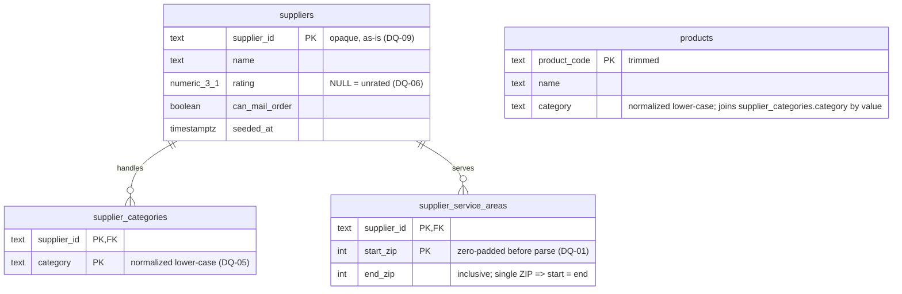
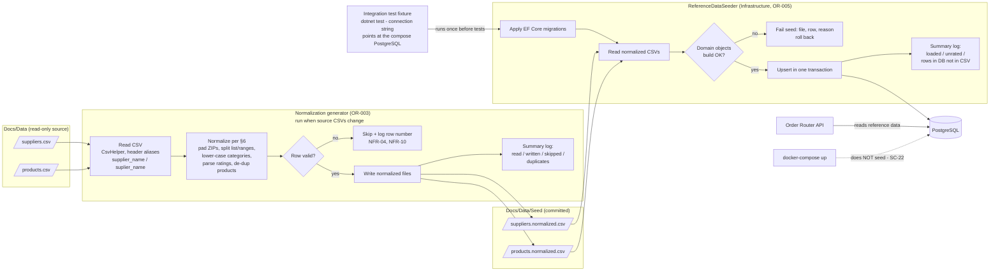
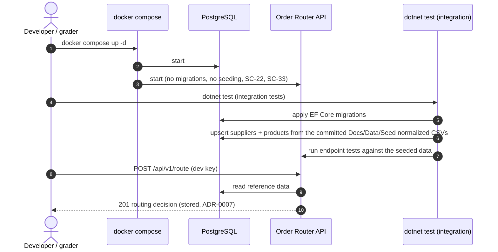
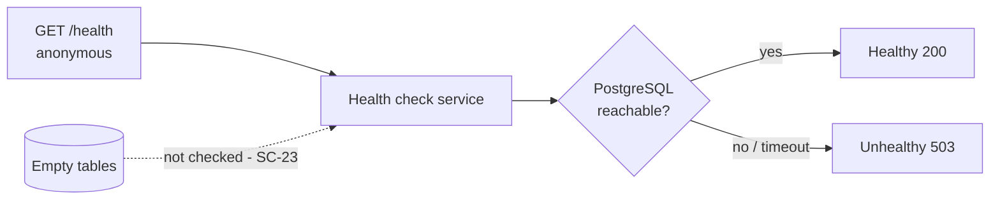

# ADR-0002: Store reference data in PostgreSQL via EF Core, seeded by an explicit migrate + upsert step

| | |
|---|---|
| **Status** | proposed |
| **Deciders** | Architecture (author), Product stakeholder |
| **Date** | 2026-11-15 |
| **Technical Story** | Candidate **C-04** in [Order-Router-Technical-Requirements.md §13](../BusinessRequirements/Order-Router-Technical-Requirements.md#13-candidate-adrs). Requirements: BR-03, FR-04, SC-20, SC-21, SC-22, SC-33, DQ-01..DQ-14, NFR-02, NFR-03, NFR-04, NFR-06, NFR-08, NFR-10, OQ-24 |

## Context and Problem Statement

The stakeholder decided: **seed from CSV, serve from the database** (SC-20). The CSVs stay the input (BR-03), and routing reads only from the database. Migrations and an **idempotent upsert seed** run **when the integration tests run** (SC-21) and **only there**: `docker-compose up` and API startup do not seed (SC-22). The README explains how to run the API and then run the integration tests, which migrate and upsert-seed the API's database (SC-24).

The data is small and read-mostly: **1,100 suppliers, 1,200 products, 24 categories, ~5,500 ZIP tokens** that become service-area segments. It is also messy (§6: 4-digit ZIPs, mixed lists and ranges, casing drift, `suplier_name` typo, duplicate products). The hot query is: *"suppliers that handle category C and (serve ZIP Z and are not mail-only | can mail order)"*.

**Which database technology should hold supplier and product reference data, and how are schema, migrations and seeding done?**

## Decision Drivers

- **SC-20 / NFR-02**: a real shared store that several stateless API instances read concurrently.
- **Hot query shape**: category membership + "ZIP inside an inclusive range" lookups, p95 < 50 ms end to end (NFR-03).
- **Idempotent upsert** (FR-04, SC-21): running the seed twice gives the same data, no duplicates.
- **Container-friendly** (BR-19, NFR-07): runs in docker-compose on the developer's Apple Silicon Mac and in CI, and the integration tests can reach the same instance.
- **.NET 10 / EF Core 10 provider maturity** and migrations support.
- **Future use**: decision-log storage (§8, AB-04) and stored routing decisions (since decided: [ADR-0007](ADR-0007-routing-decision-persistence.md), same database).
- **Cost and timebox** (BR-22): free, quick to set up.

## Considered Options

1. **PostgreSQL** with EF Core 10 (Npgsql provider).
2. **SQL Server** with EF Core 10.
3. **SQLite** (file database) with EF Core 10.
4. **In-memory store** (EF Core InMemory provider or dictionaries loaded from CSV).

## Decision Outcome

Chosen option: **"1. PostgreSQL with EF Core 10 (Npgsql)"**. It is the only option that meets all of the following: a real shared server for horizontally scaled instances, a native idempotent upsert (`INSERT … ON CONFLICT DO UPDATE`), a small multi-arch container image for compose and tests, and room for JSONB decision logs later. The open-source license keeps cost at zero.

### Schema (physical)

Indexes: `supplier_categories (category, supplier_id)` for category lookups; `supplier_service_areas (start_zip, end_zip)` for range containment (`start_zip <= @zip AND end_zip >= @zip`). At ~5,500 segments a B-tree is enough. PostgreSQL `int4range` + GiST is the upgrade path if measurements require it.

**Not stored:** "mail-only" (SC-09). It depends on the configurable `NationwideZipRange` (FR-09), so the domain derives it at read time. Persisting it would freeze a configuration value into data.

### Seeding and migrations (SC-21, SC-22)

Seeding happens in two separate steps:

1. **Normalization generator ([OR-003](../Tickets/OR-003-csv-normalization.md)).** It reads the raw source files in `Docs/Data` and applies the §6 rules. It writes clean files to `Docs/Data/Seed/` (`suppliers.normalized.csv`, `products.normalized.csv`), and those files are **committed to the repository**. You run it when the source CSVs change. Neither the seeder nor the API runs it. The source files in `Docs/Data` are read-only inputs and are never modified. The generator owns all data-quality reporting: skipped rows with reasons, and duplicate products. Its output is deterministic, so regenerating unchanged input produces no diff.
2. **Seeder ([OR-005](../Tickets/OR-005-reference-data-seeder.md)).** It reads only the committed normalized files and does **no normalization**. Building the domain objects from each row validates it. A row the domain rejects means the file is dirty or was edited by hand, so the seed fails and rolls back. It never fixes or skips that row.

Upsert semantics (FR-04):

- `suppliers`, `products`: `INSERT … ON CONFLICT (pk) DO UPDATE` with the CSV values.
- `supplier_categories`, `supplier_service_areas` (child sets): for each supplier in the CSV, **replace the set** (delete that supplier's child rows, then insert) in the same transaction. Re-running produces identical rows.
- **No deletes** of suppliers/products missing from the CSVs (OQ-24 default, still open). The summary log reports how many such rows exist.
- Fail fast (FR-04) if a normalized file is missing, has no rows, or has a row the domain rejects: the seeder throws, rolls back, and the integration test run fails. API startup never reads or checks reference data. Conflicting duplicate products fail the **generator** (DQ-12), so they never reach the normalized files.

The seeder is **one class in Infrastructure**, called **only** by the integration-test fixture (SC-22, SC-24). There is no separate seed command.

- The fixture reads its connection string from configuration/environment (e.g., `ConnectionStrings__OrderRouter`). It defaults to the docker-compose PostgreSQL, so **running the tests seeds the database the API reads from**.
- Because the seed is an upsert, running the tests again is safe and leaves the data unchanged.
- Tests treat reference data as read-only (NFR-08), so they never leave test-only reference rows behind. They do leave the routing orders they `POST` in the order tables ([ADR-0007](ADR-0007-routing-decision-persistence.md)); those are ordinary stored orders.

### Getting started (what the README documents)

### Read path

The API never writes **reference data**. It only inserts stored routing orders into separate tables ([ADR-0007](ADR-0007-routing-decision-persistence.md)). Repositories (interfaces in Domain, EF Core implementations in Infrastructure) use `AsNoTracking` projections into domain reference objects.

**Health (SC-23, NFR-06):** `/health` checks that **dependency services are up and reachable**. Today the only dependency is PostgreSQL. The check uses ASP.NET Core health checks, e.g. `AddDbContextCheck<OrderRouterDbContext>()`, which opens a connection. It does **not** check row counts or the schema: a reachable database is healthy even when it is empty or not yet migrated (SC-33). Empty reference data is a seeding concern, not an availability concern. API startup does not inspect the data either; it only needs dependencies to be reachable. The README getting-started steps tell the reader to run the integration tests to seed the data.

### Positive Consequences

- Several API instances share one consistent data set (NFR-02).
- The seed is safe to repeat; test runs always start from current schema and known data, including the sentinel suppliers (NFR-08).
- Normalization (§6) is applied in one place, the OR-003 generator, as pure, unit-testable functions. The seeder only validates.
- The cleaned data is committed and reviewable. A change to the cleaning rules or the source CSVs shows up as a diff in `Docs/Data/Seed/`, and the original source files are never modified.
- JSONB and range types are available later for decision logs (AB-04) and ZIP indexing without changing engines.

### Negative Consequences

- **No schema on a fresh `docker-compose up`** (SC-22, SC-33). The API never applies migrations, so the tables do not exist until the integration tests run. A grader who skips the tests sees `/health` = Healthy (the database is up) yet gets **500** on every `POST` and `GET`. Once migrated, an empty database gives 201 with every item `UNKNOWN_PRODUCT`. Nothing at startup points to the cause, so the README must list "run the integration tests" as a required step right after starting the API (see SC-32).
- **Integration tests are coupled to the running environment.** They need the compose PostgreSQL up, and they write (upsert) into the database the API serves from. They are not isolated per run like an ephemeral test database would be. That is acceptable because the upsert is idempotent and tests only read reference data.
- One more container to run.
- **Committed normalized files can go stale.** If someone edits a source CSV in `Docs/Data` and doesn't rerun the generator, the seed loads the old data. The fix is to regenerate and commit the files in the same change as the source update.
- Routing per request now includes a database round trip; NFR-03 must be benchmarked (caching question in [ADR-0006](ADR-0006-reference-data-caching.md)).
- Child-set replacement briefly holds row locks during seeding. That is acceptable because seeding only happens when the integration tests run.

## Pros and Cons of the Options

### 1. PostgreSQL (chosen)

- Good, because native upsert (`ON CONFLICT`), range types and GiST, JSONB for future logs.
- Good, because Npgsql EF Core provider is mature on .NET 10; small multi-arch image (runs natively on Apple Silicon).
- Good, because it is free and open source.
- Bad, because it adds a second container to the compose file.

### 2. SQL Server

- Good, because it has first-class EF Core support and is common in .NET organizations.
- Bad, because it is **expensive**. Production use needs paid licensing (per core or server + CAL). The free editions don't fit: Developer is licensed for non-production use only, and Express is capped in database size and compute. PostgreSQL has no license cost.

### 3. SQLite

- Good, because it needs no server, fast tests, and supports `ON CONFLICT` upsert.
- Bad, because a file in one container can't be shared by horizontally scaled instances (NFR-02).
- Bad, because of limited `ALTER TABLE` support in migrations, and behaviour diverges from a production server engine.

### 4. In-memory store

- Good, because it is fastest and simplest.
- Bad, because it **violates SC-20** (serve from the database). EF InMemory is also not a relational engine, so tests would not reflect real queries.

## Links

- Stored routing orders in the same database: [ADR-0007](ADR-0007-routing-decision-persistence.md).
- Caching on top of this store: [ADR-0006](ADR-0006-reference-data-caching.md).
- Normalized category keys follow the [requirements implementation note §5.1](../BusinessRequirements/Order-Router-Technical-Requirements.md#51-implementation-note-capability-matching-c-03-no-adr-sc-27).
- Open items: OQ-24 (delete rows removed from CSVs). Grader access and seeding instructions: SC-32 (resolved OQ-18).
