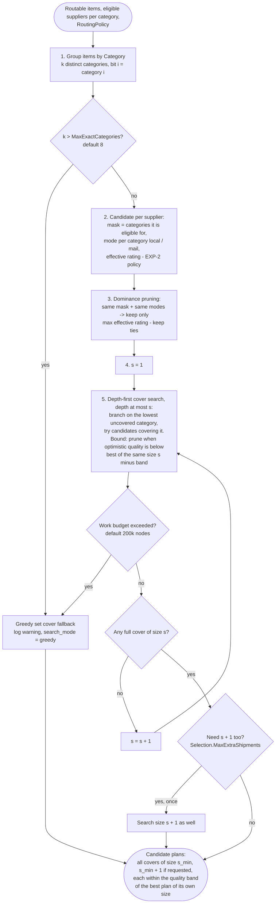
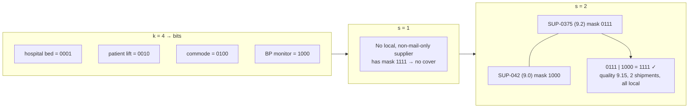

# ADR-0003: Exact minimum-shipment cover search with pruning, a work budget, and a greedy fallback

| | |
|---|---|
| **Status** | proposed |
| **Deciders** | Architecture (author), Product stakeholder |
| **Date** | 2026-11-15 |
| **Technical Story** | Candidate **C-05** in [Order-Router-Technical-Requirements.md §13](../BusinessRequirements/Order-Router-Technical-Requirements.md#13-candidate-adrs). Requirements: BR-07, BR-11..BR-14, FR-10..FR-13, §7.2, §7.3, NFR-01, NFR-03 |

## Context and Problem Statement

A **routing plan** assigns each routable line item to one eligible supplier. Ranking is lexicographic (§7.3): max items routed → **min shipments** → max quality → more local within the similarity band → deterministic pick on a full tie (lowest supplier IDs; a random pick is the EXP-4 treatment only). Minimizing shipments is **set cover**, which is NP-hard in general.

What the data tells us (profiled 2026-11-15):

| Fact | Value | Consequence |
|---|---|---|
| Distinct categories in the catalog | 24 | A category set fits in a `uint` bitmask |
| Distinct categories per sample order | ≤ 4 | Typical *k* is tiny |
| Suppliers per category | 233–277 | With `mail_order=true`, about half are eligible nationwide → **100+ candidates per category** |
| Suppliers with exactly 1 category | 232 of 1,100 | Many specialists → many equivalent options |

Naive enumeration of all assignments for a 4-category mail order is about 120⁴ ≈ 2×10⁸ plans, which is far too slow for NFR-03 (p95 < 50 ms).

Two more constraints shape the search:

- FR-13 needs **every** plan tied on keys 1–4, not just one optimum, so the tie-break (deterministic in the core, random in the EXP-4 treatment) chooses among all of them.
- The EXP-1 treatment (ADR-0001) needs plans with **one extra shipment** too.

**What algorithm finds the best plans exactly for realistic orders, stays bounded on pathological ones, and supports full-tie enumeration and EXP-1?**

## Decision Drivers

- **Exactness for realistic orders**: sentinels (T007 generalist vs specialists) and sample orders (ORD-002 → 2 shipments) must match the strict ranking.
- **Latency**: p95 < 50 ms (NFR-03) including the database read.
- **Fair ties** (FR-13): collect all plans tied on keys 1–4.
- **EXP-1 support**: explore `minShipments + MaxExtraShipments`.
- **Bounded worst case**: no request can run away; degradation must be visible (logged).
- **No heavy dependencies**: timebox (BR-22), container simplicity.

## Considered Options

1. **Brute-force enumeration** of every assignment (Cartesian product of eligible suppliers per category).
2. **Exact cover search by increasing shipment count**, with category grouping, bitmasks, dominance pruning, quality branch-and-bound, a work budget, and a greedy fallback.
3. **Greedy set cover only** (repeatedly pick the supplier covering most uncovered categories, break ties by rating).
4. **ILP / constraint solver** (e.g., Google OR-Tools CP-SAT) with lexicographic objectives.

## Decision Outcome

Chosen option: **"2. Exact cover search by increasing shipment count"**. It is exact where it matters (small *k*, which covers every sample and sentinel), returns all tied plans for FR-13, naturally supports "+1 shipment" for EXP-1, and is bounded by explicit, configurable guard rails.

### In plain words

Think of an order as a **checklist of product categories** (for ORD-002: hospital bed, patient lift, commode, blood pressure monitor). Each supplier can tick off some of the boxes. Every supplier we use means **one more box arriving at the patient's door**, so we want to tick every box with **as few suppliers as possible**. Among the options with that minimum, we want the **best-rated** suppliers.

The search works like this:

1. **Merge repeated categories.** Two CPAP lines are one "CPAP" box, because the same supplier always ships both.
2. **Try one supplier first.** Can any single supplier tick every box? If yes, the answer uses one shipment, and we only compare those suppliers.
3. **If not, try pairs, then groups of three, and so on.** The first group size that ticks every box is the minimum number of shipments. We stop growing there. The only exception is the "one extra shipment" experiment arm (EXP-1), which also looks one size further.
4. **Skip combinations that can't win**, so the search stays fast:
   - **Look-alike suppliers.** If two suppliers tick exactly the same boxes in the same way (local or mail), only the better-rated one can ever be chosen, so we drop the other. If they have the **same** rating, we keep both, so the tie-break sees every equal candidate (e.g., T003 vs T004).
   - **Hopeless half-built plans.** While building a plan, if even the best possible ending can't come close to the best plan found so far **with the same number of suppliers**, we abandon it early. Plans with different numbers of suppliers are never compared here, because the "one extra shipment" arm needs the best plan of each size.
5. **Have a safety limit.** We count how many combinations we've checked. If an unusually large order would take too long (more than 8 different categories, or more than 200,000 checks), we switch to a quick "good enough" method: keep picking the supplier that ticks the most remaining boxes. When that happens we log it, so we can see whether the limit is ever hit in practice.

**Why not the alternatives, in plain words:**

- **Check every possible combination**: a 4-category mail order has roughly 200 million combinations, which is far too slow for a 50 ms response.
- **Only the quick "good enough" method**: it's fast, but it can send more boxes than necessary. It also returns a single answer, so we can't pick fairly among equally good suppliers.
- **An external optimization solver library**: it gives exact answers, but it's a heavy extra dependency, and it's awkward to make it list every equally good answer. That's overkill for orders with a handful of categories.

**Terms used below:**

| Term | Meaning |
|---|---|
| Set cover | The textbook name for "tick every box using as few suppliers as possible". |
| Bitmask | A compact way to store which boxes a supplier ticks, as one number where each bit is a category. It makes "together, do these suppliers tick every box?" a single fast operation. |
| Dominance pruning | Dropping look-alike suppliers that can never win (step 4, first bullet). |
| Branch-and-bound | Abandoning half-built plans that can't come close to the best one (step 4, second bullet). |
| Greedy fallback | The quick "good enough" method used only when the safety limit is hit. |
| Node budget | The safety limit on how many combinations we check. |

### Algorithm (technical detail)

Details:

- **Category grouping first** (§7.2): items of one category always go to one supplier. That never adds a shipment and never loses feasibility, and it reduces the problem from items to *k* categories.
- **Assignment inside a cover**: when several chosen suppliers cover the same category, give it to the higher effective rating, then local, which maximizes plan quality for that supplier set. Remaining exact ties surface as separate plans for the tie-break.
- **Dominance pruning** is exact: replacing a supplier with one that has the same mask and modes and a higher effective rating never worsens any ranking key. Equal-rating twins are kept, so FR-13 still sees every tied supplier (e.g., T003/T004).
- **Quality bound** keeps every plan within `similarity_band` of the best plan **with the same shipment count**, so ranking key 4 (local preference) can still apply. Within one shipment count, plans below `best − band` can never win. The bound is never applied across shipment counts: in the EXP-1 treatment a minimum-shipment plan beats a better plan with one more shipment when the uplift is below `quality_uplift_threshold`, so it must reach the selection policy.
- **Unfulfillable categories** (no eligible supplier) are removed before the search. The EXP-3 policy decides what that means (ADR-0001).
- **Guard rails** (configuration, NFR-05): `PlanSearch:MaxExactCategories` (default 8), `PlanSearch:NodeBudget` (default 200,000). Exceeding either switches to greedy, logs a warning, and records `search_mode: "greedy"` in the decision log (AB-04). Defaults are confirmed or tuned by the NFR-03 benchmark.

### Worked example: ORD-002 (ZIP 77059, no mail)

### Positive Consequences

- Exact results for all sample orders and sentinels; the same ranking code serves every arm.
- Bitmask operations make each search node a few CPU instructions. Dominance pruning collapses hundreds of specialists to a handful of distinct candidates per (mask, mode) class.
- Complete tie-breaking input: all tied plans are returned, never just "the first found".
- Degradation is explicit, bounded, and observable rather than a latency spike.

### Negative Consequences

- More complex than greedy. It needs focused unit tests: sentinel T007, ORD-002, a full-tie set (T003/T004), a band case, an EXP-1 case (the +1-shipment plan is better by more than the band but less than the uplift threshold), and a budget-exhaustion case.
- On the greedy fallback, results are not guaranteed optimal, and FR-13 tie fairness is weaker. This is acceptable only because it is rare and logged.
- Default thresholds are educated guesses until the benchmark runs.

## Pros and Cons of the Options

### 1. Brute-force enumeration

- Good, because it is trivially correct.
- Bad, because it explodes combinatorially: ~2×10⁸ plans for a 4-category mail order. It fails NFR-03.

### 2. Exact cover search with pruning and guard rails (chosen)

- Good, because it is exact for realistic *k*, returns all ties, and supports EXP-1's +1 shipment.
- Good, because it has a predictable worst case through the node budget.
- Bad, because the implementation is more involved and needs targeted tests.

### 3. Greedy set cover only

- Good, because it is simple and fast (O(k · n)).
- Bad, because it can use more shipments than necessary (violates BR-12 priority), and it returns one plan, not the tied set (FR-13).
- Bad, because rating-based tie handling inside greedy is order-dependent and hard to reason about.

### 4. ILP / constraint solver

- Good, because it is exact at any scale.
- Bad, because a native solver dependency is heavy for the container and the timebox.
- Bad, because lexicographic objectives need several solves, and **enumerating all tied optima** for FR-13 is awkward.

## Links

- Consumes `MaxExtraShipments` and `IEffectiveRatingPolicy` from [ADR-0001](ADR-0001-routing-strategy-composition.md).
- Relies on `Category` equality ([requirements implementation note §5.1](../BusinessRequirements/Order-Router-Technical-Requirements.md#51-implementation-note-capability-matching-c-03-no-adr-sc-27)).
- Latency budget interacts with [ADR-0006](ADR-0006-reference-data-caching.md).
