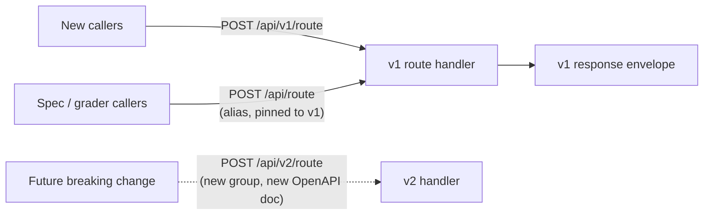
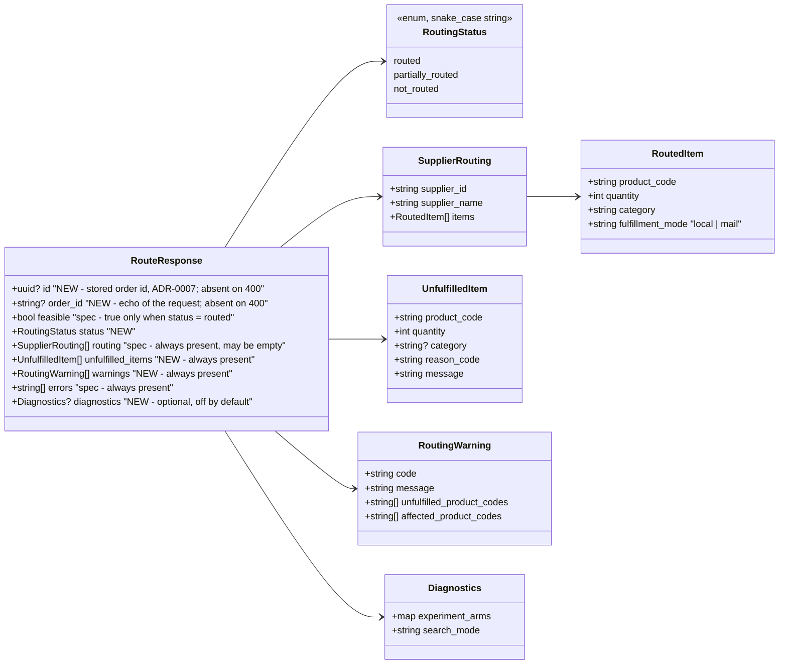
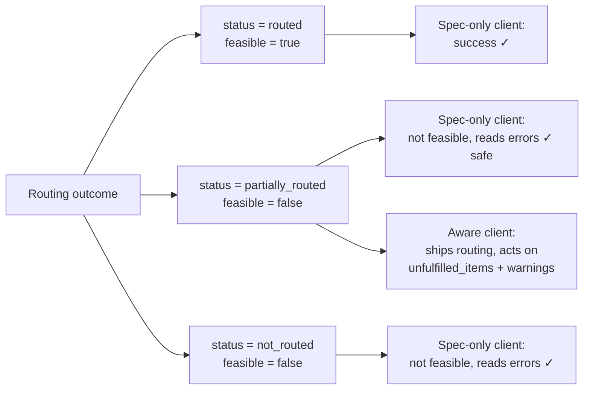

# ADR-0004: Version the routing API from v1 and evolve it with additive fields

| | |
|---|---|
| **Status** | proposed |
| **Deciders** | Architecture (author), Product stakeholder |
| **Date** | 2026-11-15 |
| **Technical Story** | Candidate **C-06** in [Order-Router-Technical-Requirements.md §13](../BusinessRequirements/Order-Router-Technical-Requirements.md#13-candidate-adrs). Requirements: BR-15..BR-18, FR-01, FR-14, FR-15, FR-16, DEV-02, SC-05, SC-15, AB-05, OQ-08, §9 |

## Context and Problem Statement

The spec defines a small response: `feasible`, `routing[]`, `errors[]` (BR-17, BR-18). Approved changes add information the spec shape cannot carry:

- **Partial routing** (EXP-3 treatment, SC-04/SC-05): `status: "partially_routed"` with `feasible: false`.
- **Unfulfilled items with reason codes** in both EXP-3 arms (FR-14).
- The same envelope for **400** responses (SC-15).
- Possibly **experiment diagnostics** (AB-05, OQ-08, still open).

Existing callers (and the take-home grader) call `POST /api/route` (BR-15) and read only `feasible`, `routing`, and `errors`.

The service has no clients yet besides the grader, so this is the cheapest moment to put a version in the URL. Adding one after callers exist means a migration.

**How do we version the contract from day one, add these fields, and still honour the spec path and spec-only clients?**

## Decision Drivers

- **Version from the first release**: callers bind to an explicit version, so a later breaking change needs no migration of unversioned callers.
- **Backward compatibility**: a spec-only client must keep working and must not mistake a partial route for success.
- **Spec path still works**: `POST /api/route` (BR-15, FR-01) must keep responding, since the grader calls it.
- **One contract to parse** for success (201) and 400 (SC-15).
- **Minimal infrastructure** within the timebox (BR-22).
- **Clients must not depend on experiment internals** (AB-05).

## Considered Options

1. **URL-segment v1 (`/api/v1/route`) from the start, with `/api/route` as a permanent alias for v1; additive fields within v1.**
2. **Additive fields on the unversioned `/api/route`**; introduce versioning only at the first breaking change.
3. **`/api/v1/route` only**; drop `/api/route`.
4. **Media-type / header versioning** (`Accept: application/vnd.order-router.v1+json`).
5. **No new fields**: encode partial routing and reasons only as strings in `errors[]`.

## Decision Outcome

Chosen option: **"1. URL-segment v1 from the start, with `/api/route` as a permanent v1 alias"**.

- **Canonical endpoint:** `POST /api/v1/route`, plus `GET /api/v1/route/{id}` to read a stored order ([ADR-0007](ADR-0007-routing-decision-persistence.md)). Documentation, examples, `.http` files, and new callers use it.
- **Spec alias:** `POST /api/route` runs the same v1 handler with the same contract, auth, and validation. It is **pinned to v1**: it never moves to a later version, so its callers are never broken silently.
- **Within v1, all approved changes are additive.** `feasible` keeps its meaning ("everything routed").
- **Lightweight mechanism:** an ASP.NET Core route group per version (`app.MapGroup("/api/v1")`). The v1 handler is registered on the group and on the alias path. One OpenAPI document named `v1` describes it. A versioning library (e.g., `Asp.Versioning.Http`) is added only when v2 appears.

### Envelope

### Contract rules

| Rule | Why |
|---|---|
| `POST /api/v1/route` is canonical. `POST /api/route` is an alias for v1 and is **never** repointed to a later version. | Explicit versions for new callers; spec path (BR-15) keeps its contract for good. |
| Both paths share one handler, one auth policy (FR-19), and one validator. Integration tests run the core cases against both paths. | The alias cannot drift from v1. |
| `feasible == (status == "routed")`. Enforced by constructing the DTO from the domain outcome, never set independently. | A spec-only client never treats a partial route as complete (DEV-02). |
| Arrays are **always present** (empty, never `null`). | Clients iterate without null checks; same shape for 201 and 400 (SC-15). |
| JSON uses `snake_case` (`JsonNamingPolicy.SnakeCaseLower`); enums serialize as snake_case strings. | Matches the spec field names (FR-01). |
| Unknown **request** fields (`priority`, `notes`) are ignored. | Tolerant reader (DQ-15). |
| `errors[]` repeats one human-readable line per unfulfilled item. | Spec-only clients still see why routing failed. |
| A valid `POST` returns **201 Created** with `Location: /api/v1/route/{id}` and `id` + `order_id` in the body (both paths). `GET /api/v1/route/{id}` returns the stored order (requirements §9.5) and exists on v1 only; the alias stays POST-only. | Stored decisions are resources (SC-28, SC-30, [ADR-0007](ADR-0007-routing-decision-persistence.md)). |
| `diagnostics` is emitted only when `Routing:ExposeDiagnostics = true` (default `false`). | AB-05: clients must not depend on it. OQ-08 is still open, so we adopt its recommended default. |
| Within v1, adding new optional fields or new enum values documented as extensible is non-breaking. Removing or renaming fields, or changing the meaning of `feasible`, **is** breaking and requires `/api/v2/route`; v1 and the alias keep the v1 contract. | Clear trigger and target for the next version. |
| A version is retired only with notice: `Deprecation` and `Sunset` response headers (RFC 9745, RFC 8594) for at least one release before removal. The alias is retired only together with v1. | Callers get a machine-readable warning. |
| The OpenAPI document `v1` (`AddOpenApi("v1")`) is the published contract, with examples for routed, partially routed, not routed (201), 400, and `GET` (200, 404). The alias is listed but marked as an alias of the canonical path. | Single source of truth for callers. |

### How each client type sees the outcomes

### Positive Consequences

- Every caller is bound to a version from the first release. A future breaking change ships as v2 with no migration of existing callers.
- The spec path and the grader keep working unchanged; they get the full v1 behaviour, including partial routing.
- Zero breaking changes for spec-only clients' response parsing.
- A single envelope for 201 and 400 keeps client code simple (SC-15).
- The `feasible`/`status` invariant is enforced in one place, so partial routes cannot be mistaken for success.

### Negative Consequences

- Two paths serve v1. Tests must cover both, and the alias must be documented so callers know it is pinned, not "latest".
- Spec-only clients that see `feasible:false` on a partial route will **not** ship the routed part. The benefit of partial routing reaches only clients that read `status`. This is intended (fail safe) but limits EXP-3's reach.
- Route groups do not provide version negotiation, `api-supported-versions` headers, or version-aware OpenAPI. When v2 arrives, adopting `Asp.Versioning.Http` is extra setup work.
- The status-code change (201/400/401 instead of always 200, DEV-07, DEV-14) is a separate, already-approved breaking change governed by organization standard C-08. It applies to both paths and is not covered by this ADR.

## Pros and Cons of the Options

### 1. `/api/v1/route` + pinned `/api/route` alias (chosen)

- Good, because callers bind to an explicit version before any exist outside the grader, so there is nothing to migrate later.
- Good, because the BR-15 path keeps working and the grader exercises the real v1 behaviour.
- Good, because route groups need no new packages.
- Bad, because two paths serve one contract, and tests must cover both.

### 2. Additive fields, unversioned

- Good, because it has the least infrastructure and only one path.
- Bad, because the first breaking change forces versioning onto callers who never chose a version, and it relies on discipline to recognise that moment.

### 3. `/api/v1/route` only

- Good, because there is a single, explicit path.
- Bad, because it breaks BR-15/FR-01; the grader and spec-only callers would get 404.

### 4. Media-type / header versioning

- Good, because URLs stay clean.
- Bad, because it is harder to try from curl, `.http` files, or graders, and adds content-negotiation complexity.

### 5. Encode everything in `errors[]`

- Good, because the shape doesn't change at all.
- Bad, because clients would have to parse strings to find which items were routed and which weren't. It is not machine-actionable, and SC-04 needs users to act on unfulfilled items.

## Links

- `partially_routed` and `warnings` come from `PartialRoutingPolicy` in [ADR-0001](ADR-0001-routing-strategy-composition.md).
- `diagnostics.experiment_arms` comes from [ADR-0005](ADR-0005-experiment-assignment.md).
- Status codes and error handling: organization standard C-08 (no ADR, SC-19).
- Stored orders and the `GET` endpoint: [ADR-0007](ADR-0007-routing-decision-persistence.md).
