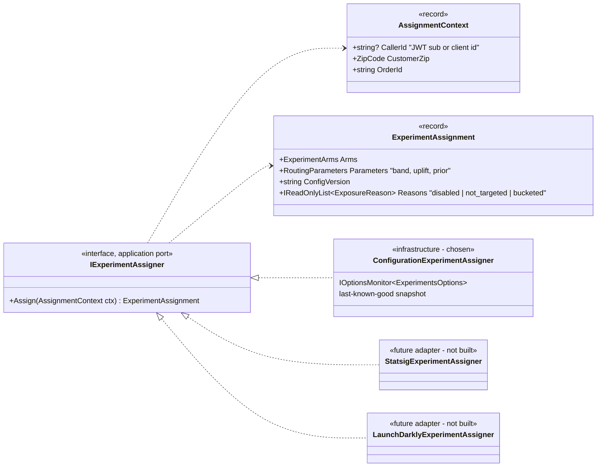
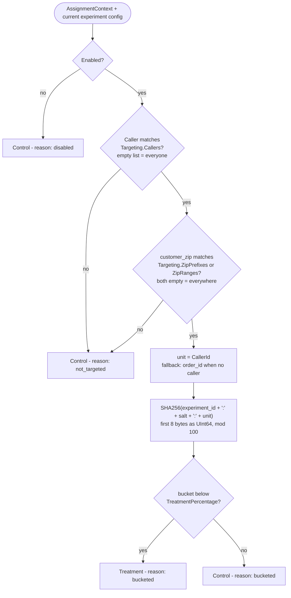
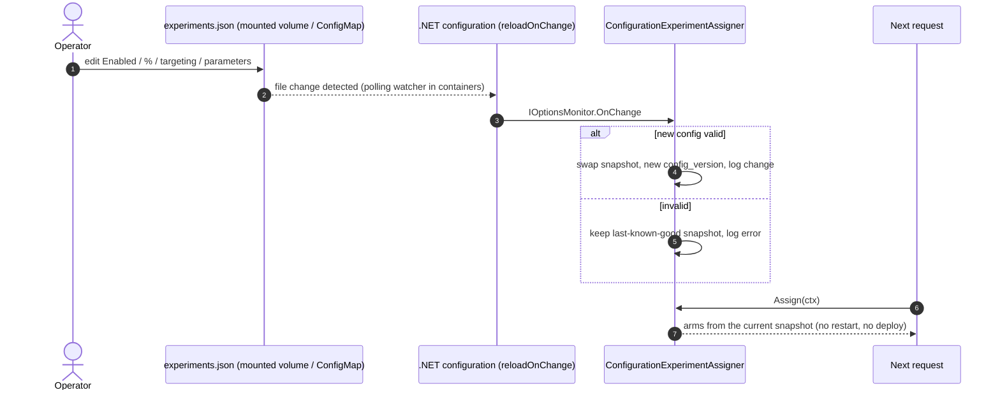

# ADR-0005: Vendor-agnostic experiment assignment with user/region targeting, configured in reloadable appsettings

| | |
|---|---|
| **Status** | proposed |
| **Deciders** | Architecture (author), Product stakeholder |
| **Date** | 2026-11-15 |
| **Technical Story** | Candidate **C-07** in [Order-Router-Technical-Requirements.md §13](../BusinessRequirements/Order-Router-Technical-Requirements.md#13-candidate-adrs). Requirements: AB-01..AB-05, §8.1, §8.2, §8.3, NFR-01, NFR-05, SC-10, SC-18, **SC-25, SC-26** |

## Context and Problem Statement

Three independent experiments (EXP-1, EXP-2, EXP-3) decide which policies route an order ([ADR-0001](ADR-0001-routing-strategy-composition.md)). The stakeholder added three requirements:

- **SC-25**: experiments can be **turned on/off without deploying code**. Keep it simple: **appsettings, no feature-flag service** for now. The design must allow a later move to a managed experiment platform (e.g., Statsig, LaunchDarkly) **without touching routing code**.
- **SC-26**: roll out **by user or by region**.
  - The *user* is the **authenticated caller** (JWT `sub`, or the client ID).
  - A *region* is a set of **customer ZIP prefixes or ranges**.
  - Experiments **target first, then split by user**: only matching orders can be in treatment, and among them a user always sees the same arm.

The previous version of this ADR bucketed by `order_id` and read static options. That cannot target users or regions. Changing it also required a restart.

**How is an order assigned to experiment arms so that rollout can be targeted by user and region, changed at runtime without a deploy, and later moved to a managed platform without changing routing code?**

## Decision Drivers

- **Runtime control without deploy** (SC-25): enable/disable, traffic %, targeting, and parameters.
- **Targeting** by caller and by ZIP prefix/range (SC-26).
- **Consistent experience per user**: the same caller gets the same arm on every order (SC-26).
- **Determinism** across processes, instances, and restarts (AB-01, NFR-01). `string.GetHashCode()` is per-process randomized and **must not** be used.
- **Vendor-agnostic** (SC-25): routing and policies never reference a vendor SDK.
- **Fail safe**: bad config or a missing identity must fall back to control, never to a broken state (CLAUDE.md, AB-03).
- **Simplicity and timebox** (BR-22): no new infrastructure.
- **Privacy**: no PII beyond `customer_zip` in logs (AB-04). Caller identities are pseudonymized.

## Considered Options

1. **Configuration-based assigner behind a vendor-agnostic port**: reloadable appsettings (`IOptionsMonitor`), targeting rules (callers, ZIP prefixes/ranges), salted SHA-256 bucketing on the caller ID.
2. **Microsoft.FeatureManagement** (library, still appsettings-based) with its targeting filter (users, groups, rollout %) and variants.
3. **Managed experiment platform now** (Statsig, LaunchDarkly, …) through its SDK.
4. **Keep the previous design**: static options, bucketing by `order_id`.

## Decision Outcome

Chosen option: **"1. Configuration-based assigner behind a vendor-agnostic port"**. It meets SC-25 and SC-26 with no new dependency or service. The port is the seam where a Statsig or LaunchDarkly adapter can be added later.

### Port and adapters



The application layer builds `AssignmentContext` from the authenticated principal and the validated order. The caller ID comes from the `sub` claim, falling back to the client ID claim. The development key maps to the fixed caller `dev-key`. Nothing outside Infrastructure knows where the configuration comes from.

### Assignment algorithm (per experiment)



- Each experiment is evaluated independently with its own salt, so arms are independent (AB-01).
- **Same caller → same arm** on every order inside the targeted regions. A caller can be treatment in a targeted region and control elsewhere, because targeting is checked per order.
- Ramp-up is monotonic: raising the percentage only moves callers from control to treatment.
- ZIP prefixes and ranges in the configuration are written as zero-padded 5-digit ZIPs (e.g., `02100-02199`) and parsed with the domain `ZipRange` type. Nothing pads them (padding exists only in the normalization generator, OR-003), so a 4-digit value fails validation and the last-known-good snapshot stays active.

### Configuration and runtime reload (SC-25)

```jsonc
// experiments.json, mounted into the container and reloaded on change.
// NOTE: kept in appsettings on purpose (SC-25). If we need a UI, audit trail, or
// built-in analysis, implement IExperimentAssigner with Statsig or LaunchDarkly.
// Routing code does not change.
"Experiments": {
  "Exp1ConsolidationVsQuality": {
    "Enabled": false, "TreatmentPercentage": 0, "Salt": "exp1",
    "Targeting": { "Callers": [], "ZipPrefixes": [], "ZipRanges": [] },
    "Parameters": { "QualityUpliftThreshold": 2.0 }
  },
  "Exp2UnratedSuppliers": {
    "Enabled": true, "TreatmentPercentage": 20, "Salt": "exp2",
    "Targeting": { "Callers": [], "ZipPrefixes": ["021", "100"], "ZipRanges": ["30000-30999"] },
    "Parameters": { "UnratedPrior": 6.5 }
  },
  "Exp3PartialRouting": {
    "Enabled": false, "TreatmentPercentage": 0, "Salt": "exp3",
    "Targeting": { "Callers": ["portal-client", "user-123"], "ZipPrefixes": [], "ZipRanges": [] }
  }
},
"Routing": { "SimilarityBand": 0.5 }
```

(Example values for illustration. The shipped defaults are **all disabled**, which means all control, AB-03.)



- The file is added with `AddJsonFile(path, optional: true, reloadOnChange: true)`. Containers set `DOTNET_USE_POLLING_FILE_WATCHER=true`, because file-change events do not reliably reach containers through bind mounts or ConfigMap symlink swaps.
- **Validation**: `ValidateOnStart` makes startup fail on invalid config. On reload, an `IValidateOptions` check runs, and an invalid change keeps the **last-known-good** snapshot (fail safe). The assigner never throws on the request path.
- **Environment variables** still override for bootstrap values, but changing them needs a restart, not a deploy.
- `config_version` = short SHA-256 of the canonical JSON of the active snapshot. It is recomputed on every accepted reload.

### Exposure / decision logging (AB-04)

One `RoutingDecisionMade` structured event per valid POST, written after its order is stored ([ADR-0007](ADR-0007-routing-decision-persistence.md)), whatever the outcome; 400 and 401 requests produce none. Emitted via `[LoggerMessage]` source generation. It contains:

- `id` (stored order UUID, [ADR-0007](ADR-0007-routing-decision-persistence.md)) and `order_id`
- **`caller_hash`** (HMAC-SHA256 of the caller ID with a server secret; the raw caller ID is not logged)
- per experiment: `arm` and `reason`
- chosen suppliers and modes
- tied candidates and the random pick
- `shipment_count`, `plan_quality`, `unrated_chosen`, `unfulfilled_count`
- `search_mode`, `config_version`, `customer_zip`

Arms appear in the response only through the optional `diagnostics` object ([ADR-0004](ADR-0004-response-contract-evolution.md), off by default).

### Positive Consequences

- Product can turn experiments on and off, ramp them up, and retarget them by editing one file, with no deploy (SC-25).
- Targeted rollouts by caller and region (SC-26); consistent arms per caller.
- Routing and policies depend only on `ExperimentAssignment`. Adding a Statsig/LaunchDarkly adapter is an Infrastructure change plus a DI registration.
- Bad config never reaches requests; the last-known-good snapshot keeps serving.

### Negative Consequences

- **Single service identity risk**: if all traffic comes from one upstream orchestrator with one service token, every order has the same caller. That caller is then entirely in treatment or entirely in control, so the split becomes a regional rollout. Real per-user splits need the upstream to pass the end user's identity (e.g., an on-behalf-of token). This is tracked as **OQ-25**.
- **Statistical caveat**: bucketing by caller clusters orders. With few callers, arms can be unbalanced, and analysis must treat the caller (not the order) as the unit of randomization.
- **Arms can change between retries** if the configuration changes in between. Analysts must segment by `config_version`. The caller treats the first response as authoritative (SC-18).
- No UI and no change audit beyond file history and the reload log. That is the trigger to adopt a managed platform.
- Each instance reloads independently, so there is a short window in which instances may disagree after an edit.

## Pros and Cons of the Options

### 1. Configuration-based assigner behind a port (chosen)

- Good, because it has no new dependency or service, is transparent, and is easy to unit-test (pure function of context + snapshot).
- Good, because it covers runtime toggling, targeting, and user-consistent splits.
- Bad, because operators edit JSON with no UI, and changes are audited only through file history.

### 2. Microsoft.FeatureManagement

- Good, because it is appsettings-based, reloadable, and has a built-in targeting filter (users, groups, rollout %) and variants.
- Bad, because ZIP-range targeting needs a custom filter or a group-mapping workaround, and its allocation semantics are less transparent to test.
- Bad, because it adds a library for logic that is ~100 lines here. It remains a reasonable intermediate step before a managed platform.

### 3. Managed platform now (Statsig, LaunchDarkly)

- Good, because it provides a UI, audit trail, targeting, and built-in experiment analysis.
- Bad, because it is a vendor, cost, and SDK dependency, and sends identifiers to a third party, which needs compliance review in a healthcare context.
- Bad, because the stakeholder explicitly deferred it (SC-25). The port keeps it a later adapter.

### 4. Static options, bucketing by `order_id`

- Good, because it is the simplest deterministic design.
- Bad, because it can't target users or regions (SC-26) and needs a restart to change.

## Links

- Produces `ExperimentAssignment` (arms + parameters) for [ADR-0001](ADR-0001-routing-strategy-composition.md).
- Diagnostics exposure: [ADR-0004](ADR-0004-response-contract-evolution.md).
- Decision caching is ruled out partly because arms depend on caller and live config: [ADR-0006](ADR-0006-reference-data-caching.md).
- The same `caller_hash` is stored with each routing order and used for the ownership check on `GET`: [ADR-0007](ADR-0007-routing-decision-persistence.md).
- Authentication (source of the caller ID): organization standard C-12, FR-19.
- Open items: OQ-25 (end-user identity through the orchestrator), OQ-08, OQ-09, OQ-10.

## Implementation notes (OR-016)

- **Caller ID claims:** `sub`, then `client_id` (RFC 9068), then `azp` (OIDC). Blank values count as missing. With no claim the caller is `null` and the order ID is the unit. The dev key already carries `sub = dev-key`.
- **Experiment IDs** are the configuration section keys (`Exp1ConsolidationVsQuality`, `Exp2UnratedSuppliers`, `Exp3PartialRouting`), the same names as the `ExperimentArms` properties. Each has its own salt, so arms are independent.
- **Bucket:** `SHA256(UTF8("{id}:{salt}:{unit}"))`, first 8 bytes read with `BinaryPrimitives.ReadUInt64BigEndian`, modulo 100. The byte order is explicit so results match on every platform; a known-answer test pins the values (computed outside .NET).
- **`config_version`:** the first 12 lowercase hex characters of SHA-256 over a canonical JSON of the *parsed* values in a fixed order, with numbers normalized. A whitespace-only edit keeps the version; any value change alters it.
- **Reload design (decided by a spike):** a failed `IValidateOptions` check on reload makes `IOptionsMonitor` throw inside its own change callback, on the file-watcher thread, without notifying listeners (`OptionsMonitorReloadSpikeTests`). So validation is **not registered** on the options system. `ExperimentsOptionsValidator` (an `IValidateOptions` class over the one mapper) is called directly by a startup check and the assigner calls the same mapper on every change. Behaviour matches the ADR: invalid config stops startup, an invalid reload keeps the last-known-good snapshot and logs an error. Binding failures (for example text where a number is expected) are recorded as a validation error instead of thrown, for the same reason.
- **Missing and malformed files:** a missing `experiments.json` means every experiment is disabled. A file that is not valid JSON fails startup; on reload the provider fails before it notifies anyone, so the last-known-good snapshot stays.
- **Source order:** `experiments.json` is inserted before the environment-variable source, so environment variables and the command line still override it (pinned by a host test).
- **Containers:** the compose file mounts the file read-only and sets `DOTNET_USE_POLLING_FILE_WATCHER=true`. A single-file bind mount follows the file's inode, so an edit must overwrite the file **in place**; a save that replaces the file (`sed -i`, an editor that renames a temp file) detaches the mount until the container restarts. Verified by hand against the compose stack.
- **Known risk until OR-017..019:** `RoutingPolicyFactory` still throws for treatment arms. Enabling an experiment in a real deployment makes targeted treatment requests return 500. The shipped file keeps every experiment disabled.

## Implementation notes (OR-018)

- **EXP-2 treatment** is `ColdStartPriorPolicy`. `RoutingPolicyFactory` builds it per request with `ExperimentAssignment.Parameters.UnratedPrior`, so the policy never reads configuration and the next request after a reload uses the new prior (ADR-0001).
- **Equal fulfillment modes in the acceptance fixture:** the similarity band only prefers local over mail among plans of equal shipment count. A 6.5 prior and a 6.0 rating are within the 0.5 band, so a local 6.0 supplier would beat a mail unrated one. The AC2/AC3 tests use two local suppliers.
- **Known risk until OR-017 and OR-019:** the factory still throws for EXP-1 and EXP-3 treatment. Enabling either in a real deployment makes targeted treatment requests return 500. Enabling only EXP-2 works.
