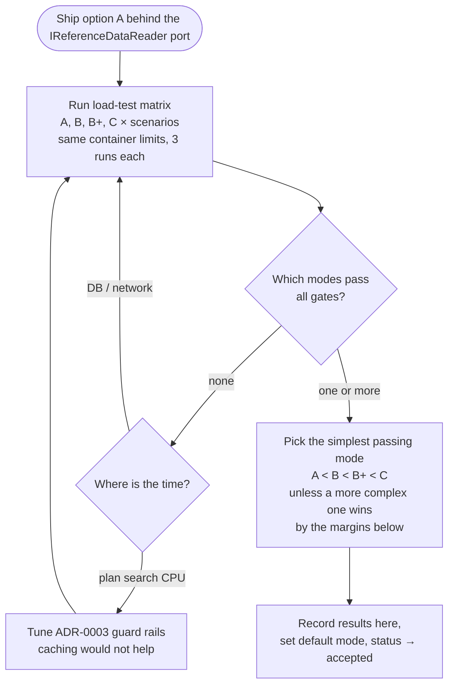

# ADR-0006: Choose reference-data caching from load-test results; no decision caching

| | |
|---|---|
| **Status** | proposed (caching option pending load-test results) |
| **Deciders** | Architecture (author), Product stakeholder |
| **Date** | 2026-11-15 |
| **Technical Story** | Candidate **C-09** in [Order-Router-Technical-Requirements.md §13](../BusinessRequirements/Order-Router-Technical-Requirements.md#13-candidate-adrs). Requirements: NFR-02, NFR-03, NFR-01, FR-13, SC-17, SC-18, SC-20, SC-22. Also answers the caching questions in [AI_PROMPTS.md](../AI_PROMPTS.md#questions) |

## Context and Problem Statement

Routing reads reference data from PostgreSQL ([ADR-0002](ADR-0002-reference-data-database.md)). The data is small: ~1,100 suppliers, ~5,500 ZIP segments, 1,200 products, roughly a few MB in memory. It changes **only** when the integration tests run the upsert seed (SC-22, SC-24). The latency target is **p95 < 50 ms** including database reads (NFR-03), and caching is explicitly this ADR's decision.

The team also asked:

- *Does a distributed cache such as Redis make sense?*
- *Can we cache each combination of order / supplier / ZIP for faster decisions, and how would invalidation work?*

Reasoning about the data size suggests an in-process cache would win, but nobody has measured it yet. Committing to an option, or ruling one out on performance grounds, before measuring would be guessing.

**Which caching option, if any, gives the best latency / CPU / memory trade-off for this workload, and how do we decide from evidence rather than assumption?**

## Decision Drivers

- **NFR-03** latency target, which must be **measured**, not assumed.
- **Resource cost**: CPU and memory per instance, plus the cost of any extra infrastructure (Redis container, PostgreSQL load).
- **NFR-02** stateless instances, horizontal scaling.
- **Correctness after a re-seed**: stale data must be bounded and predictable.
- **FR-13 / SC-17**: on a full tie the pick must be random per request.
- **Simplicity and timebox** (BR-22): every cache layer adds invalidation logic and failure modes; prefer the simplest option that meets the targets.

## Considered Options

| ID | Option | What is cached | Invalidation |
|---|---|---|---|
| **A** | **No cross-request cache** (baseline) | Nothing across requests. Per-request memoization only: eligibility per category computed once per request, one round trip per lookup kind. | None needed |
| **B** | **In-process snapshot** | An immutable, indexed `ReferenceDataSnapshot` (category → suppliers, ZIP segments, product → category) per instance, via `HybridCache` (L1 only) or `IMemoryCache`. | TTL (e.g., 5 min), rebuilt off the request path, swapped atomically |
| **B+** | **Snapshot + eligibility memo** | B, plus memoized eligibility per (category, ZIP, `mail_order`). Depends only on reference data. | Cleared with the snapshot swap |
| **C** | **Distributed cache (Redis)** | Reference data (and optionally eligibility) in Redis via `HybridCache` with a Redis L2 (`IDistributedCache`). | TTL; optional explicit removal after the seed |
| **D** | **Whole-decision cache** | Routing results keyed by (items, ZIP, `mail_order`, caller, config version). | Unbounded key set |

## Decision Outcome

**Decided now:**

1. **Ship with option A only.** Routing reads PostgreSQL through the `IReferenceDataReader` port. It is always fresh and has nothing to invalidate. No cache mode is built before the load tests.
2. **Keep A, B, B+, and C open as options**, not as code. Choose between them only after the load tests below. None is pre-approved or rejected on performance grounds.
3. **Option D is rejected on correctness grounds**, not performance, so it is not load-tested (see [Answers](#answers-to-the-teams-questions)).
4. **The port is the seam for a later cache.** Routing already depends on `IReferenceDataReader`, so whichever mode the load tests pick is added later as a decorator or adapter behind it, without changing domain code. Domain rules stay out of the cache layer: the cache holds data, not decisions.

**Decided after load tests:** whether a cache mode is built and which one. The results go into the [results table](#results) below, and this ADR moves to `accepted`.

### Load-test plan

**Environment** (identical for every mode):

- Release build of the API in its container (NFR-07), limited to **1 vCPU / 512 MB**. PostgreSQL (and Redis for C) in their own containers on the same host network, with fixed limits.
- Database seeded by the integration tests (SC-21) before each run. POST requests also insert stored orders ([ADR-0007](ADR-0007-routing-decision-persistence.md)), so the measured latency includes that write.
- 60 s warm-up excluded from results; each run lasts 5 min at steady state; **3 runs per cell**, median reported.
- Authentication through the development key (FR-19) so auth cost is included, as in production.

**Tooling:**

| Measures | Tool |
|---|---|
| Load generation, latency (p50/p95/p99), throughput, error rate | **k6** (container image), scripts in `tests/load/` |
| API CPU, working set, GC heap, allocation rate, gen-2 GCs, thread-pool queue length | `dotnet-counters` (`System.Runtime`), sampled every 1 s |
| Container CPU and memory for API, PostgreSQL, and Redis | `docker stats` |
| Database load | `pg_stat_statements` (calls and total time per query) |

**Scenarios** (each run against every mode):

| Scenario | Shape | Why |
|---|---|---|
| **S1 steady** | Constant arrival rate at the target load, realistic mix: sample orders, sentinels, 4-category mail orders | Normal operation against NFR-03 |
| **S2 worst case** | Steady target load, orders with 10 distinct categories (the NFR-03 upper bound) | Largest reference-data reads and plan search |
| **S3 ramp** | Arrival rate ramped until p95 > 50 ms or errors > 1% | Headroom: maximum sustainable throughput per instance |
| **S4 cold start / re-seed** | Restart (or re-seed) during S1 load | Latency spike while the cache warms, and how long data stays stale |

**Target load:** not yet specified by the requirements (see OQ-26 in the [ADR index](README.md#open-items-carried-by-these-adrs)). Assumed default: **100 requests/s per instance**.

### Selection rules

A mode **passes** only if, in S1 and S2 at the target load, it meets all of these gates:

| Gate | Threshold |
|---|---|
| Latency | p95 < 50 ms (NFR-03); p99 < 100 ms |
| Errors | < 0.1% non-2xx/4xx responses |
| CPU | API container ≤ 70% of its limit (headroom for spikes) |
| Memory | API working set ≤ 300 MB and stable over the run (no growth trend) |
| Staleness (S4) | Data no older than the configured TTL after a re-seed |

Among passing modes, pick the **simplest** (A < B < B+ < C). Choose a more complex mode only if, against the simpler passing one, it gives **at least one** of:

- ≥ 30% lower p95 in S1 or S2, or
- ≥ 25% lower API CPU at the target load, or
- ≥ 30% more sustainable throughput in S3,

**and** its total resource cost (API + PostgreSQL + Redis containers, CPU and memory) is not higher. For C, the Redis container counts against it.

### Results

To be filled in after the load tests (medians of 3 runs, target load unless noted).

| Mode | S1 p95 (ms) | S2 p95 (ms) | S3 max req/s | API CPU % | API working set (MB) | DB calls / request | Extra containers | Passes gates |
|---|---|---|---|---|---|---|---|---|
| A — none | | | | | | | — | |
| B — snapshot | | | | | | | — | |
| B+ — snapshot + eligibility | | | | | | | — | |
| C — Redis | | | | | | | Redis | |

**Chosen default mode:** _pending_.

### Rules for any caching mode that is adopted

- Cached reference data is **immutable** and swapped atomically (no locks on the request path, NFR-02).
- Staleness is bounded by the TTL. Because seeding only happens when the integration tests run (SC-22, SC-24), a TTL is enough; mode C may also clear its keys after the seed.
- Mail-only classification and normalization rules stay in the domain. Caches hold data, not decisions.
- Cache mode, snapshot age, hit ratio, and row counts are emitted as logs/metrics, **not** as health status. `/health` stays a dependency-availability check (SC-23, [ADR-0002](ADR-0002-reference-data-database.md)). In mode C, a Redis outage falls back to PostgreSQL rather than failing requests.

### Answers to the team's questions

| Question | Answer |
|---|---|
| **Redis / distributed cache?** | **Kept open and measured (option C).** The expectation is that it will not beat an in-process snapshot: the whole data set fits in each instance's memory, and a Redis read is a network hop similar to the PostgreSQL query it replaces, plus serialization and an extra container. A distributed cache usually pays off when data is large, expensive to compute, or must be shared *consistently* across instances. The load tests confirm or refute this expectation on CPU, memory, and latency rather than assuming it. |
| **Cache per order / supplier / ZIP combination?** | **Not whole decisions (option D, rejected for correctness).** (1) A full tie must be re-picked at random per request (FR-13, SC-17), and a cached decision would freeze it. (2) Arms depend on the caller, the region, and experiment config that can be reloaded at runtime (ADR-0005), so the same items + ZIP can legitimately route differently for another caller or after a config change. (3) The key space is items × quantities × ZIPs × mode × config, so the hit rate is near zero for unique orders. (4) Every supplier change would invalidate an unbounded set of keys. **The safe, narrower form is option B+**: memoize *eligibility* per (category, ZIP, `mail_order`), which depends only on reference data and is cleared with the snapshot swap. It is in the load-test matrix. |

### Positive Consequences

- The caching choice rests on measured latency, CPU, and memory, not on assumptions.
- All non-decision options stay possible behind one port, and the choice can be revisited if load or data size changes.
- Option A ships first: always-fresh data and nothing to invalidate until the measurements justify more.
- Randomness and experiment semantics are never compromised by cached outputs.

### Negative Consequences

- The load tests need the candidate modes as prototypes (at least B) to measure them. That work is deferred until load testing is scheduled, so it does not compete with the timebox (BR-22, NFR-09).
- Mode C needs a Redis container in the load-test environment (not in the default `docker-compose` profile).
- Until the results are in, this ADR cannot be accepted and the default stays A, which may miss NFR-03 on slow infrastructure.
- Any adopted cache introduces bounded staleness (up to the TTL) after a re-seed. The README must say so, or document a restart.
- The selection margins and gates are judgment calls; they are written down here so the choice is reproducible.

## Pros and Cons of the Options

### A. No cross-request cache (baseline, shipped first)

- Good, because it is simplest, always fresh, and needs no invalidation logic.
- Bad, because it adds database latency and PostgreSQL load on every request.

### B. In-process snapshot

- Good, because reads are in-memory lookups, and the data size makes per-instance copies cheap.
- Good, because the immutable swap needs no locks, and staleness is bounded by the TTL.
- Bad, because every instance holds a copy (a few MB), and data is stale for up to the TTL after a re-seed.

### B+. Snapshot + eligibility memo

- Good, because it skips recomputing eligibility for repeated (category, ZIP, mode) combinations.
- Bad, because it adds memory proportional to distinct combinations seen, and only helps if the workload repeats them.

### C. Distributed cache (Redis)

- Good, because instances share one cache, and a re-seed can be published by clearing keys once.
- Bad, because each read adds a network hop and deserialization, plus a new container and outage mode.

### D. Whole-decision caching (rejected)

- Good, because a hit would skip the plan search entirely.
- Bad, because it is **incorrect** under the FR-13 random tie-break and per-caller experiment arms.
- Bad, because the near-unique keys give a negligible hit rate and unbounded invalidation.

## Links

- Store being cached: [ADR-0002](ADR-0002-reference-data-database.md).
- CPU-side guard rails: [ADR-0003](ADR-0003-plan-search-algorithm.md).
- Randomness and arms that forbid decision caching: [ADR-0001](ADR-0001-routing-strategy-composition.md), [ADR-0005](ADR-0005-experiment-assignment.md).
