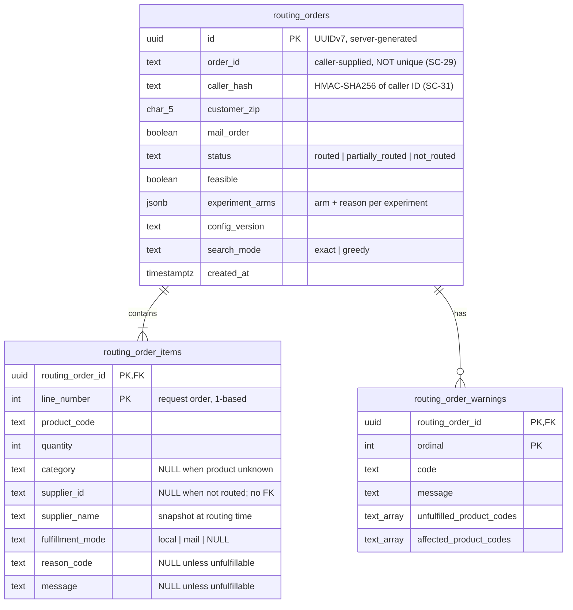
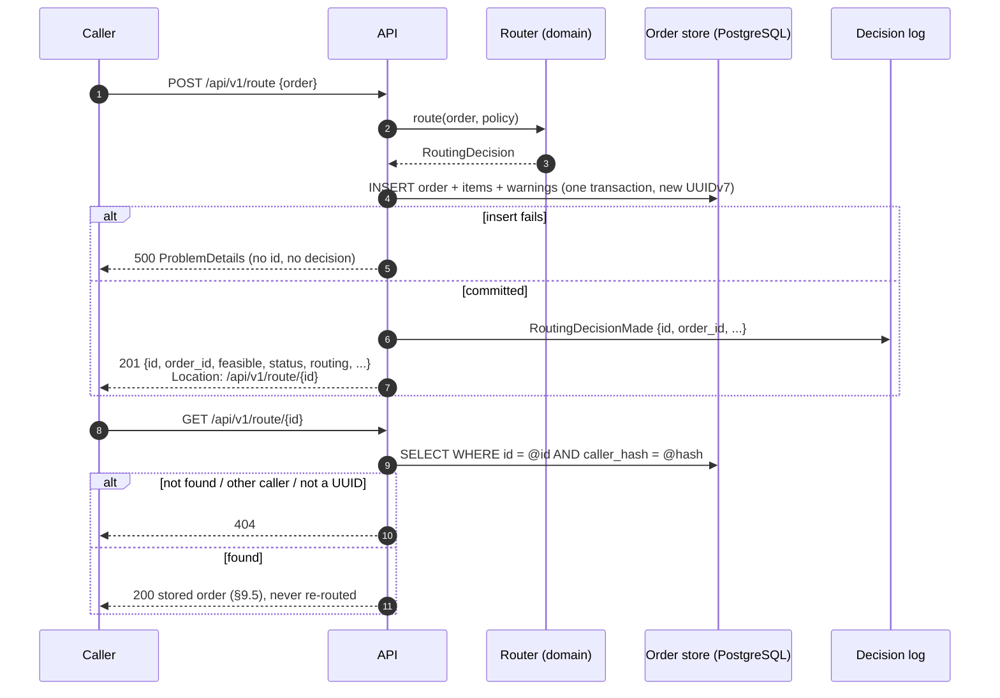

# ADR-0007: Store every routing decision in PostgreSQL and expose it by UUID

| | |
|---|---|
| **Status** | proposed |
| **Deciders** | Architecture (author), Product stakeholder |
| **Date** | 2026-11-15 |
| **Technical Story** | Candidate **C-13** in [Order-Router-Technical-Requirements.md §13](../BusinessRequirements/Order-Router-Technical-Requirements.md#13-candidate-adrs). Requirements: FR-02, FR-20, FR-21, NFR-01, NFR-02, §9.4, §9.5, SC-28, SC-29, SC-30, SC-31, OQ-27, OQ-28 |

## Context and Problem Statement

Until now the router was stateless: it returned a decision and kept nothing (SC-18). The stakeholder now wants:

- **SC-28**: `POST` stores every valid routing outcome (routed, partially routed, not routed): the requested items, the supplier chosen for each item, unfulfilled items and warnings. The response returns a server-generated UUID `id`.
- **SC-29**: every `POST` creates a **new** record with a new UUID, retries included. The service does not de-duplicate by `order_id`.
- **SC-30**: a valid `POST` returns **201 Created** with a `Location` header.
- **SC-31**: `GET /api/v1/route/{id}` returns the stored order, **only to the caller that created it**.

Reference data already lives in PostgreSQL ([ADR-0002](ADR-0002-reference-data-database.md)) and is read-only for the API.

**How do we store routing decisions so that a stored order can be read back exactly as it was returned, without coupling it to reference data that the seed can change later?**

## Decision Drivers

- **Read back what was returned**: `GET` must show the same suppliers, names, modes and reasons as the original `POST`, even after a re-seed changes reference data.
- **Never return an `id` that can't be read** (fail safe): storing and responding must be all-or-nothing.
- **No re-routing on `GET`**: an EXP-4 treatment random tie-break (FR-13) must not change when the order is read again.
- **Ownership** (SC-31) without storing raw caller identities (privacy, AB-04).
- **Horizontal scaling** (NFR-02): any instance can serve any `GET`.
- **Latency** (NFR-03): one extra insert per `POST`.
- **Timebox** (BR-22): reuse the existing database, EF Core and migration process.

## Considered Options

1. **Relational tables in the existing PostgreSQL database** (order, one row per requested line, warnings).
2. **One JSONB document per order** in the existing database.
3. **Use the decision log (AB-04) as the store** and read orders back from logs.
4. **A separate database** for orders.

## Decision Outcome

Chosen option: **"1. Relational tables in the existing PostgreSQL database"**. It reuses the existing database, EF Core context and migrations. It keeps each line's outcome queryable (e.g. "orders routed to `SUP-0810`") and is easy for a junior engineer to read.

### Schema

- **One item row per requested line.** A routed line has the supplier columns filled in. An unfulfillable line has `reason_code` and `message`. A line that was routable but held back by all-or-nothing (EXP-3 control) has neither, and the order's `status` explains why.
- **No foreign key to `suppliers`.** Stored orders are historical records. The supplier name is copied at routing time, so a re-seed (or a future delete, OQ-24) never changes or blocks a stored order.
- **`errors[]` is not stored.** For a valid request it is derived from the unfulfilled lines' messages, so `GET` rebuilds it the same way `POST` does.
- **Indexes:** primary keys, plus `routing_orders (order_id)` for support look-ups.
- Same EF Core context (`OrderRouterDataContext`) and migrations as reference data. Migrations still run only from the integration tests (SC-21, SC-22). The seeder never touches these tables.

### Request flow

### Rules

| Rule | Why |
|---|---|
| `id` is a UUIDv7 (`Guid.CreateVersion7()`), generated by the server. | Time-ordered keys keep the primary-key index compact. Callers can't choose or guess IDs. |
| Every valid `POST` inserts a new order, even if the same caller already sent the same `order_id`. | SC-29. The caller treats the first response as authoritative (SC-18). |
| Insert all rows in one transaction **before** responding. If it fails, return 500 and no decision. | Never hand out an `id` that can't be read back. |
| Emit the decision log event (AB-04) only after the commit, including `id`. | The log and the store agree. |
| `GET` filters by `id` **and** `caller_hash`. A miss, another caller's order, or a non-UUID `id` all return 404. | SC-31, and 404 does not reveal whether an `id` exists. |
| `caller_hash` uses the same `ICallerHasher` (HMAC-SHA256, server secret) as the decision log. | No raw caller IDs at rest ([ADR-0005](ADR-0005-experiment-assignment.md)). |
| `GET` is available on `/api/v1/route/{id}` only. The spec alias `/api/route` stays POST-only. | The alias exists only for spec compatibility ([ADR-0004](ADR-0004-response-contract-evolution.md)). |
| Reference-data tables stay read-only for the API. | [ADR-0002](ADR-0002-reference-data-database.md); the API only inserts into the order tables. |

### Positive Consequences

- Callers and support can read any decision back exactly as it was returned, including a random tie-break pick under the EXP-4 treatment.
- Stored orders are unaffected by later re-seeds.
- No new infrastructure: same database, same migrations, same context.
- Instances stay stateless in memory and can serve any `GET` (NFR-02).

### Negative Consequences

- **Retries create duplicates.** `POST` is not idempotent by design (REST semantics, CLAUDE.md REST API conventions; SC-29). EHRs and clearinghouses retry, so a retry creates a second record and may pick a different tied supplier. Downstream consumers must use the first `id` they receive (OQ-28). If de-duplication is ever required, the REST-conventional way is an explicit `Idempotency-Key` request header, not matching on `order_id`.
- **The data grows without bound.** There is no retention or delete policy yet (OQ-27).
- **One more write on the hot path.** NFR-03 must be measured with the insert included. If the database is down, `POST` now fails with 500 instead of still returning a decision.
- **Status codes change** from 200 to 201 for `POST` (SC-30), which adds to the grader risk in DEV-07.
- **Shared caller identity** (OQ-25): when all traffic uses one service identity, every order has the same `caller_hash`, so any user of that identity can read every order.
- **Caching is unaffected.** Option D (whole-decision cache) in [ADR-0006](ADR-0006-reference-data-caching.md) stays rejected. Stored orders are records, not a cache, and are never reused to answer a new `POST`.

## Pros and Cons of the Options

### 1. Relational tables in the existing database (chosen)

- Good, because it reuses the existing database, EF Core context and migrations.
- Good, because each line's outcome can be queried.
- Bad, because it needs three tables and mapping code.

### 2. One JSONB document per order

- Good, because there is one row per order and the response maps straight to storage.
- Bad, because querying by supplier or reason code needs JSON operators, and the document shape gets tied to the API contract version.

### 3. Decision log as the store

- Good, because the data is already emitted (AB-04).
- Bad, because logs are not a transactional, queryable store. A `GET` can't promise to find an order that was just returned, and logs don't support ownership checks.

### 4. Separate database

- Good, because it isolates order write load from reference-data reads.
- Bad, because it means another container, connection string and migration set, which is out of proportion at this scale.

## Links

- Reference data and migrations: [ADR-0002](ADR-0002-reference-data-database.md).
- Response fields `id`, `order_id`, 201, and the `GET` contract: [ADR-0004](ADR-0004-response-contract-evolution.md).
- Caller hash and decision log: [ADR-0005](ADR-0005-experiment-assignment.md).
- Open items: OQ-27 (retention), OQ-28 (duplicates from retries), OQ-25 (shared service identity).

## Implementation notes (OR-026)

- **`caller_hash` is nullable.** A token with no caller claim has no caller ID (ADR-0005, OR-016). The order is stored with `NULL`, and `GET` filters by `caller_hash = @hash`, which never matches `NULL`, so nobody can read such an order back (fail safe).
- **`search_mode` is nullable.** When no product is known, no plan search runs, so there is no mode to store.
- **Extra check constraints** (defence in depth, in the style of `ck_suppliers_rating`): `status` in (`routed`, `partially_routed`, `not_routed`), `search_mode` in (`exact`, `greedy`) or null, `fulfillment_mode` in (`local`, `mail`) or null, `quantity >= 1`, `line_number >= 1`, `ordinal >= 1`.
- **`id` is never generated by the database.** The server sets the UUIDv7 (OR-027).
- **Cascade is inside the order only.** Items and warnings are deleted with their order. There is no foreign key to `suppliers`; a re-seed that renames or drops a supplier leaves stored orders unchanged (test: `SeedAsync_WithStoredOrders_LeavesTheOrderTablesUnchanged`).
- **Migration:** `AddRoutingOrderTables`. It only adds the three tables and `ix_routing_orders_order_id`.

## Implementation notes (OR-027)

- **One transaction.** `RoutingOrderStore` adds the order with its items and warnings and calls `SaveChangesAsync` once, so a rejected row rolls everything back. The service saves **before** it answers: a failed save throws, the global handler returns a 500 ProblemDetails, and no `id` is returned. A test makes the real database reject the insert (check constraint) and finds no rows.
- **Ports.** `IRoutingOrderStore` and `ICallerHasher` are Domain ports; the EF store and `HmacCallerHasher` are Infrastructure. `StoredRoutingOrderFactory` builds the stored order from the command, the decision and the mapped response, so the stored status, messages and warnings are exactly what the caller received.
- **Item rows.** One row per requested line. Routed and unfulfilled lines are both in request order, so one ordered walk matches them to the requested lines, duplicates included. A line in neither list was held back by all-or-nothing and gets no supplier and no reason.
- **Caller hash.** `HMAC-SHA256(secret, caller ID)` as lowercase hex, key from `CallerHashing:Secret` (environment variable or user-secrets, never a committed file). A missing secret stops the host at startup. A token with no caller claim stores `NULL`: the order is stored and returned, but a `GET` can never match it.
- **`id` and `created_at`.** `Guid.CreateVersion7()` and `TimeProvider` in the service, so tests can fix the clock.
- **Location.** `/api/v1/route/{id}` on both paths. `RouteController` builds it from the stored order's `id` with `Url.RouteUrl`, so it never sends a `Location` without a stored order.
- **Not verified here:** p95 latency with the extra insert (NFR-03, needs the load test). `GET` was added in OR-028 (below).

## Implementation notes (OR-028)

- **Ownership is in the query.** `RoutingOrderReader` filters `id` and `caller_hash` in one `WHERE`. There is no existence check before the ownership check, so another caller's order and a missing one are the same `null` and the same 404 (SC-31). A stored `NULL` hash never equals a value, so an order stored without a caller is never found.
- **No caller ID, no query.** `GetStoredOrderService` returns `null` without calling the reader when the token has no caller ID.
- **One 404.** Unknown id, an id that is not a UUID, another caller's order and an order with no caller all return the same Problem Details body (same title and detail; only the per-request `trace_id` differs).
- **Parse after authentication.** The `id` is a `string` in the controller action and is parsed with `Guid.TryParseExact(value, "D")`. A `{id:guid}` route constraint would answer a bodiless 404 before authentication, so an anonymous call to `/api/v1/route/abc` would not get 401.
- **Rebuilt, not recomputed.** `RoutingOrderMappingExtensions` rebuilds `routing` (grouped by the supplier's first line), `unfulfilled_items` and `errors` from the stored item rows, the same way `RoutingOrderMappingExtensions` built them on POST. Reading never routes, so the supplier of a tie-break is the one POST stored. Lines held back by all-or-nothing appear only in `items`.
- **Snapshot.** The read queries only the order tables and never joins reference data, so a re-seed cannot change the supplier name (test: `FindAsync_SupplierRenamedAfterRouting_StillShowsTheRoutingTimeName`).
- **`created_at`** is written as ISO 8601 UTC with a `Z` by `UtcTimestampJsonConverter`; the default writer would emit `+00:00` for a value read from PostgreSQL.
- **No alias.** There is no `GET` under `/api/route`.
- **Not in this ticket:** `diagnostics` on GET (OR-022), retention (OQ-27), listing and deleting orders.
