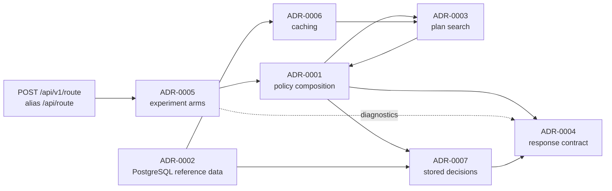

# Architecture Decision Records

ADRs for the Order Router. They are derived from [Order-Router-Technical-Requirements.md](../BusinessRequirements/Order-Router-Technical-Requirements.md) §13.

| ADR | Candidate | Decision | Status |
|---|---|---|---|
| [ADR-0001](ADR-0001-routing-strategy-composition.md) | C-02 | Compose routing from per-experiment policies (rating, plan selection, unfulfillable handling) plus a tie-breaker (deterministic by default; the EXP-4 treatment is random) | proposed |
| [ADR-0002](ADR-0002-reference-data-database.md) | C-04 | PostgreSQL + EF Core 10; migrate + upsert seed run only by the integration tests, against the API's database | proposed |
| [ADR-0003](ADR-0003-plan-search-algorithm.md) | C-05 | Exact min-shipment cover search with bitmasks, dominance pruning, work budget, greedy fallback | proposed |
| [ADR-0004](ADR-0004-response-contract-evolution.md) | C-06 | `POST /api/v1/route` from the start, `POST /api/route` as a permanent v1 alias; additive fields within v1 | proposed |
| [ADR-0005](ADR-0005-experiment-assignment.md) | C-07 | Vendor-agnostic assigner port; target by caller and ZIP region, then split by caller; reloadable appsettings (no deploy); Statsig/LaunchDarkly as future adapters | proposed |
| [ADR-0006](ADR-0006-reference-data-caching.md) | C-09 | Ship without a cache; choose none / in-process snapshot / snapshot + eligibility memo / Redis from load tests (latency, CPU, memory); no decision caching | proposed (pending load tests) |
| [ADR-0007](ADR-0007-routing-decision-persistence.md) | C-13 | Store every valid routing decision in PostgreSQL (new UUID per POST, 201 + Location); `GET /api/v1/route/{id}` for the creating caller only | proposed |

C-01, C-08, C-10, C-11, and C-12 are organization standards and have no ADR (SC-19). C-03 (capability matching) is an implementation note in the [requirements doc §5.1](../BusinessRequirements/Order-Router-Technical-Requirements.md#51-implementation-note-capability-matching-c-03-no-adr-sc-27), not an ADR (SC-27).

## How the decisions fit together

## Open items carried by these ADRs

| Item | Affects | Default adopted until answered |
|---|---|---|
| OQ-03 similarity band default | ADR-0001, ADR-0003 | 0.5 |
| OQ-08 experiment arms in response | ADR-0004, ADR-0005 | Logs only; `diagnostics` behind a flag, off |
| OQ-10 EXP-1/EXP-2 parameters | ADR-0001, ADR-0005 | uplift 2.0, prior 6.5 |
| OQ-18 grader access (resolved, SC-32) | ADR-0002 | README: copy `.env.example` to `.env`, run `docker compose up`, then run the integration tests to seed |
| OQ-25 single upstream service identity | ADR-0005 | Accept; per-user split degrades to a regional rollout |
| OQ-24 rows removed from CSVs | ADR-0002 | Never deleted; counted in seed summary |
| NFR-03 benchmark | ADR-0003, ADR-0006 | Required to finalize guard-rail defaults and caching |
| OQ-27 retention of stored orders | ADR-0007 | Keep indefinitely; no delete endpoint |
| OQ-28 duplicate stored orders from retries | ADR-0007 | Downstream uses the first `id` |
| OQ-26 target load for the load tests | ADR-0006 | 100 requests/s per instance, 1 vCPU / 512 MB container |
