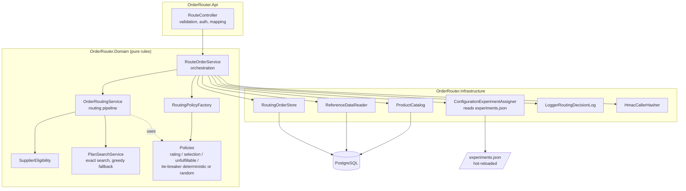
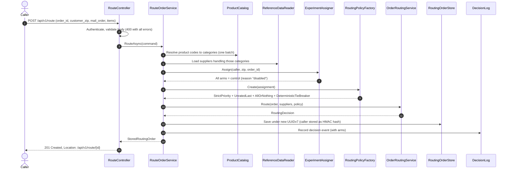
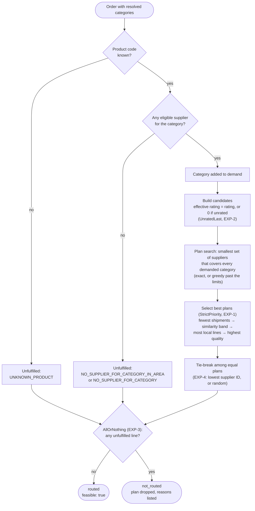
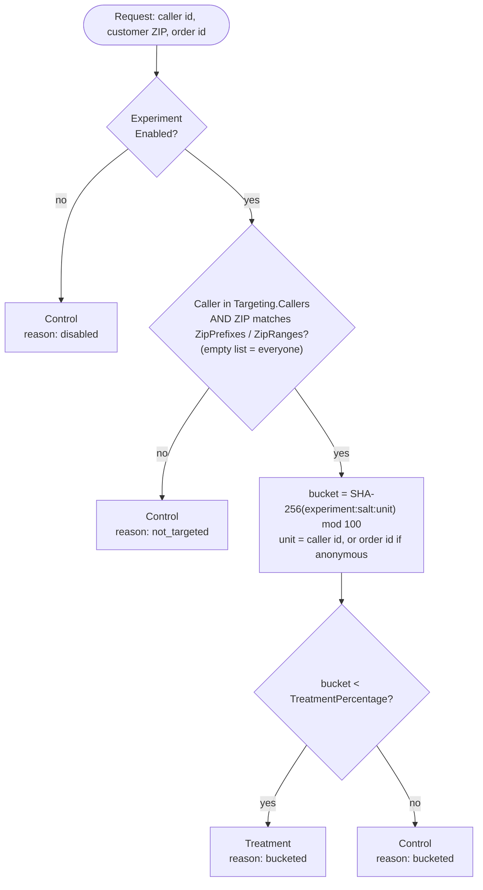
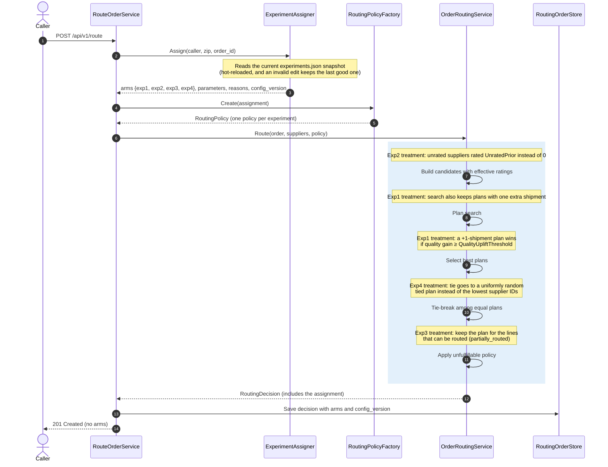

# Experiments

Four experiments can each replace one routing policy. This page covers why they exist, how they change routing, example results, how to test them and how to configure them. The routing rules they modify are described in the [README](../README.md#what-this-service-does).

- [Flow with experiments on](#flow-with-experiments-on)
- [Experiments: control vs. treatment](#experiments-control-vs-treatment)
- [Experiment tests and results](#experiment-tests-and-results)
- [Configuring experiments](#configuring-experiments)

## Flow with experiments on

Four experiments can each replace one policy in the pipeline. The pipeline itself does not change; only the policy objects plugged into it do. Experiments never touch routing code directly: they only decide **which policy objects** the pipeline is given. The [README](../README.md#components) shows the default path without them; the diagrams below add the experiment parts.

### Components with experiments



### Request flow with experiments

With all experiments disabled (the default in [experiments.json](../src/OrderRouter.Api/experiments.json)) every request still gets the control arm of all four experiments. The assignment step below is where an enabled experiment would pick a treatment arm.



### Routing pipeline with policy slots

The four policies named in the boxes are the slots an experiment can replace. The control policies are shown.



### Why each experiment exists

The stakeholder chose to A/B test three policy questions instead of fixing the answers up front ([Requirements §8](BusinessRequirements/Order-Router-Technical-Requirements.md), SC-01, SC-02, SC-04, SC-05).

- **EXP-1, consolidation vs. quality.** Two goals conflict: *"We want to do as few orders as possible but also care about ratings."* Sometimes the plan with the fewest shipments uses a weaker supplier. The question is whether it is worth adding a shipment to get a much better-rated supplier.
  - Control: fewer shipments always wins.
  - Treatment: one extra shipment is allowed, but only for a large quality gain. For example, with a threshold of 2.0, one shipment at quality 6.0 loses to two shipments at 9.0, but one shipment at 8.0 beats two at 9.0.
  - Why the treatment has a hard limit: if quality and shipment count were simply weighted against each other, an order could be split three or four ways to chase ratings, which breaks the "fewest orders" rule (BR-12).
  - Primary metric: customer satisfaction on delivered orders. Guard rails: average shipments per order, the share of single-shipment orders, the feasibility rate.
- **EXP-2, unrated suppliers.** A new supplier has no rating yet. Counted as 0, it loses to almost any rated supplier, so it never gets orders and never earns a rating. The stakeholder wants to *"give them a chance to get into our system."* The question is whether sending orders to new suppliers hurts outcomes.
  - Control: an unrated supplier counts as 0. It is still eligible, but it is chosen only when no rated supplier can do the job.
  - Treatment: an unrated supplier counts as a starting rating of 6.5 (`UnratedPrior`), so it competes with average suppliers instead of losing to all of them. In the seed data, 916 of 1,100 suppliers are rated: the mean rating is 7.10, the median 7.0 and the range 2.6 to 10. So 6.5 is about 0.6 below the mean, a slightly cautious starting point for a supplier with no history. It is a configurable default, not a computed value; it does not follow the data if the ratings change.
  - Primary metric: the share of orders routed to new suppliers, and the ratings they later earn. Guard rails: customer satisfaction, the complaint and return rates.
- **EXP-3, partial routing.** The original spec is all-or-nothing: if one item cannot be fulfilled, nothing is routed. The stakeholder's view is *"It is better to ship some items than to ship nothing."* In healthcare that change is risky, so it is tested instead of being switched on for everyone. The question is whether shipping what we can do better than holding the whole order.
  - Control: nothing is routed, and the response lists the items that could not be routed.
  - Treatment: the items that can be routed are routed and the rest are listed so a person can act on them. When [item-dependency rules](../README.md#item-dependency-rules) are configured, a routed item whose required companion was not fulfilled is flagged in `warnings` (SC-08).
  - Primary metrics: time to first delivery, the percentage of items delivered. Guard rails: orders later cancelled, patient complaints about incomplete orders, how often manual intervention is needed.
- **EXP-4, tie-breaking.** When several plans are still equal after every ranking key, the core picks the one whose supplier IDs sort first, so routing stays repeatable (FR-13, SC-17). The cost is that the same supplier always wins a given tie. The question is whether spreading ties at random is worth the loss of repeatability.
  - Control (the core behavior): `DeterministicTieBreaker` picks the tied plan whose supplier IDs sort first (ordinal), so the same order always gets the same plan and no random source is used. Plans that differ only in how categories are split between the same suppliers keep the search order.
  - Treatment: `UniformRandomTieBreaker` picks one tied plan uniformly at random. This is the only random code in the service; it is never used outside this experiment.
  - Primary metric: share of orders each supplier receives among tied plans (fairness). Guard rails: supplier acceptance rate, SLA performance of the suppliers that win ties.

The router only records which arms each decision used (in the decision log event). It cannot measure satisfaction, deliveries or complaints itself. Those metrics need a downstream feedback loop joined on the stored order `id`, and that loop is not part of this service (§8.3).

### How each experiment changes routing

| Experiment | Policy slot | Control (default) | Treatment |
|---|---|---|---|
| `Exp1ConsolidationVsQuality` | Plan selection | `StrictPriorityPolicy`: fewest shipments always wins. | `BoundedTradeOffPolicy`: the search also returns plans with **one** extra shipment; such a plan wins only if its quality is at least `QualityUpliftThreshold` (default `2.0`) above the plan control would pick. |
| `Exp2UnratedSuppliers` | Effective rating | `UnratedLastPolicy`: an unrated supplier counts as `0`. | `ColdStartPriorPolicy`: an unrated supplier counts as `UnratedPrior` (default `6.5`), so new suppliers can win orders. |
| `Exp3PartialRouting` | Unfulfillable lines | `AllOrNothingPolicy`: one unfulfillable line means nothing is routed. | `PartialRoutingPolicy`: route what can be routed, return `partially_routed` and list the rest in `unfulfilled_items`. |
| `Exp4TieBreaking` | Tie-break (ranking key 5) | `DeterministicTieBreaker`: the tied plan with the lowest supplier IDs (ordinal order); no randomness. | `UniformRandomTieBreaker`: one of the tied plans, uniformly at random. |

First, each experiment independently decides the arm for the request:



The bucket is a stable hash, so the same caller always lands in the same arm, on every instance and after restarts. Each experiment has its own salt, so the four assignments are independent and any of the eight arm combinations can occur.

Then the arms decide which policies the pipeline runs with. The highlighted steps are the ones a treatment arm changes:



The arms, the reasons and the `config_version` are written with every decision event, so outcomes can be compared per arm. They are also stored with the order (`routing_orders.experiment_arms`). The response never shows them, so callers cannot tell which arm they got. How to turn experiments on is described in [Configuring experiments](#configuring-experiments).

## Experiments: control vs. treatment

Each order below was sent twice by the same caller: first with every experiment off (control), then with **one** experiment set to `Enabled: true, TreatmentPercentage: 100` in [experiments.json](../src/OrderRouter.Api/experiments.json), using the default parameters. The file was hot-reloaded; no restart was needed.

### EXP-1: consolidation vs. quality

Order: ZIP `02101`, local, `BB-LUM-090` (back brace) + `CP-STD-031` (cpap).

| Arm | Supplier per item | Shipments | Quality |
|---|---|---|---|
| Control | Both: `SUP-0955` FirstChoice Wellness Group #955 (4.8) | 1 | 4.8 |
| Treatment | Back brace: `SUP-0956` DME Equipment Inc #956 (7.8). CPAP: `SUP-065` Essential Medical Warehouse (10.0) | 2 | **8.9** |

Control always takes the single shipment, even from a 4.8-rated supplier. The treatment adds **one** shipment because quality rises by 4.1 points, above the `QualityUpliftThreshold` of 2.0.

The threshold also stops splits that are not worth it. `ORD-001` under the same treatment **stays at one shipment** with `SUP-0810` (6.0): its best two-shipment plan (7.1 and 7.0) gains only about 1.05 points.

**Benefit:** a patient with a CPAP and a back brace gets both from well-rated suppliers instead of one weak one, for one extra delivery. The experiment measures whether that improves satisfaction more than the extra shipment costs.

**More detail:** [ticket OR-017](Tickets/OR-017-exp1-bounded-tradeoff.md) · [integration tests](../tests/OrderRouter.Api.IntegrationTests/Controllers/V1/BoundedTradeOffHostTests.cs) · [results on 125 orders](TestingAnalysis/routing_results.md#4-effect-of-exp1-to-exp3)

### EXP-2: unrated suppliers

Order: ZIP `02101`, local, `CP-STD-031` (cpap) + `GL-STD-081` (glucose meter). Only two local suppliers handle both categories: `SUP-0955` (rated 4.8) and `SUP-0781` Sunrise Mobility Network #781 (no rating yet).

| Arm | Supplier per item | Shipments | Effective rating used |
|---|---|---|---|
| Control | Both: `SUP-0955` FirstChoice Wellness Group #955 | 1 | 4.8 vs. unrated counted as 0 |
| Treatment | Both: `SUP-0781` Sunrise Mobility Network #781 | 1 | 4.8 vs. unrated counted as **6.5** |

Same number of shipments either way. In control the new supplier loses to a below-average supplier only because it has no history. In the treatment its starting rating of 6.5 beats 4.8 by more than the 0.5 similarity band.

**Benefit:** 184 of the 1,100 seeded suppliers have no rating. Under control they only get orders when nobody rated can do the job, so most of them never earn a rating. The treatment gives them real orders in low-risk cases, so the network learns which new suppliers are good.

**More detail:** [ticket OR-018](Tickets/OR-018-exp2-cold-start-prior.md) · [unit tests](../tests/OrderRouter.Tests/Domain/Services/ColdStartRoutingTests.cs) · [results on 125 orders](TestingAnalysis/routing_results.md#4-effect-of-exp1-to-exp3)

### EXP-3: partial routing

Order: ZIP `10015`, local, `WC-STD-001` (wheelchair) + `OX-PORT-024` (oxygen) + `OX-CONC-999` (not in the catalog).

| Arm | `status` | Routed | Unfulfilled | Shipments |
|---|---|---|---|---|
| Control | `not_routed` | Nothing | `OX-CONC-999`: `UNKNOWN_PRODUCT` | 0 |
| Treatment | `partially_routed` | Wheelchair and oxygen: `SUP-0810` (6.0), local | `OX-CONC-999`: `UNKNOWN_PRODUCT` | 1 |

Treatment response (`id` omitted):

```json
{
  "order_id": "EXP3-DEMO",
  "feasible": false,
  "status": "partially_routed",
  "routing": [
    {
      "supplier_id": "SUP-0810",
      "supplier_name": "Pacific Prosthetics Express #810",
      "items": [
        { "product_code": "WC-STD-001", "quantity": 1, "category": "wheelchair", "fulfillment_mode": "local" },
        { "product_code": "OX-PORT-024", "quantity": 1, "category": "oxygen", "fulfillment_mode": "local" }
      ]
    }
  ],
  "unfulfilled_items": [
    {
      "product_code": "OX-CONC-999",
      "quantity": 1,
      "category": null,
      "reason_code": "UNKNOWN_PRODUCT",
      "message": "Product code 'OX-CONC-999' was not found in the catalog."
    }
  ],
  "warnings": [],
  "errors": []
}
```

**More detail:** [ticket OR-019](Tickets/OR-019-exp3-partial-routing.md) · [integration tests](../tests/OrderRouter.Api.IntegrationTests/Controllers/V1/PartialRoutingApiTests.cs) · [results on 125 orders](TestingAnalysis/routing_results.md#4-effect-of-exp1-to-exp3)

**Benefit:** one bad line no longer blocks the whole order. The patient's wheelchair and oxygen can ship now, and only the unknown item goes to a person to fix. `feasible` stays `false`, so downstream systems still know the order is incomplete.

**With a dependency rule.** A partial route can split items that are clinically needed together. Configured [item-dependency rules](../README.md#item-dependency-rules) flag that case in `warnings`. The seeded suppliers cover every category in every real ZIP, so this example uses the test-only sentinel ZIP `00098`. There, `SUP-T014` handles wheelchairs only, so a walker cannot be fulfilled. With the illustrative rule `wheelchair` requires `walker` and EXP-3 in treatment, `WC-STD-001` + `WK-STD-009` returns (`id` omitted):

```json
{
  "order_id": "DEP-DEMO",
  "feasible": false,
  "status": "partially_routed",
  "routing": [
    {
      "supplier_id": "SUP-T014",
      "supplier_name": "Sentinel No-Coverage Control",
      "items": [
        { "product_code": "WC-STD-001", "quantity": 1, "category": "wheelchair", "fulfillment_mode": "local" }
      ]
    }
  ],
  "unfulfilled_items": [
    {
      "product_code": "WK-STD-009",
      "quantity": 1,
      "category": "walker",
      "reason_code": "NO_SUPPLIER_FOR_CATEGORY_IN_AREA",
      "message": "No supplier delivers 'walker' to the delivery ZIP."
    }
  ],
  "warnings": [
    {
      "code": "DEPENDENT_ITEM_UNFULFILLED",
      "message": "WC-STD-001 (wheelchair) is routed, but its required companion WK-STD-009 (walker) could not be fulfilled. Review before releasing.",
      "unfulfilled_product_codes": ["WK-STD-009"],
      "affected_product_codes": ["WC-STD-001"]
    }
  ],
  "errors": ["No supplier delivers 'walker' to the delivery ZIP."]
}
```

The wheelchair still ships, and the warning tells the reviewer it should not be released without the walker. The rule changed nothing in `routing`; it only added the warning. The `GET` of the same `id` returns the same warning. An unknown product (like `OX-CONC-999` above) has no category, so it never triggers a rule.

## Summary

| Scenario | Control | Treatment | What changed |
|---|---|---|---|
| EXP-1 (02101, back brace + cpap) | 1 shipment, quality 4.8 | 2 shipments, quality 8.9 | +1 shipment for +4.1 quality |
| EXP-1 (`ORD-001`) | 1 shipment, quality 6.0 | 1 shipment, quality 6.0 | Nothing: gain below threshold |
| EXP-2 (02101, cpap + glucose meter) | Rated supplier at 4.8 | New, unrated supplier | New supplier gets an order |
| EXP-3 (10015, 2 known + 1 unknown item) | 0 of 3 items routed | 2 of 3 items routed | Known items ship now |
| EXP-4 (24 of the 125 sample and production-like orders have a full tie) | Lowest supplier IDs (5 different suppliers won) | Random pick among the tied plans (14 different suppliers won in the latest run) | Same status, shipments and quality; only the winner among equals changes |

## Experiment tests and results

Where to find the detail behind each experiment. The examples above are single orders; the links below cover every arm combination and a larger run.

| Experiment | Ticket | Tests | Results |
|---|---|---|---|
| EXP-1 consolidation vs. quality | [OR-017](Tickets/OR-017-exp1-bounded-tradeoff.md) | [BoundedTradeOffHostTests](../tests/OrderRouter.Api.IntegrationTests/Controllers/V1/BoundedTradeOffHostTests.cs) | [Effect by experiment](TestingAnalysis/routing_results.md#4-effect-of-exp1-to-exp3) |
| EXP-2 unrated suppliers | [OR-018](Tickets/OR-018-exp2-cold-start-prior.md) | [ColdStartRoutingTests](../tests/OrderRouter.Tests/Domain/Services/ColdStartRoutingTests.cs) | [Effect by experiment](TestingAnalysis/routing_results.md#4-effect-of-exp1-to-exp3) |
| EXP-3 partial routing | [OR-019](Tickets/OR-019-exp3-partial-routing.md), [OR-020](Tickets/OR-020-dependency-warnings.md) | [PartialRoutingApiTests](../tests/OrderRouter.Api.IntegrationTests/Controllers/V1/PartialRoutingApiTests.cs), [DependencyWarningsApiTests](../tests/OrderRouter.Api.IntegrationTests/Controllers/V1/DependencyWarningsApiTests.cs) | [Effect by experiment](TestingAnalysis/routing_results.md#4-effect-of-exp1-to-exp3) |
| EXP-4 tie-breaking | none | [DeterministicTieBreakerTests](../tests/OrderRouter.Tests/Domain/Services/DeterministicTieBreakerTests.cs), [UniformRandomTieBreakerTests](../tests/OrderRouter.Tests/Domain/Services/UniformRandomTieBreakerTests.cs), [ExperimentArmsHostTests](../tests/OrderRouter.Api.IntegrationTests/Controllers/V1/ExperimentArmsHostTests.cs) | [Effect of Exp4](TestingAnalysis/routing_results.md#5-effect-of-exp4-tie-breaking) |
| Assignment and bucketing (all) | [OR-016](Tickets/OR-016-experiment-assignment.md) | [ExperimentAssignmentHostTests](../tests/OrderRouter.Api.IntegrationTests/Controllers/V1/ExperimentAssignmentHostTests.cs), [ExperimentArmsHostTests](../tests/OrderRouter.Api.IntegrationTests/Controllers/V1/ExperimentArmsHostTests.cs), [ConfigurationExperimentAssignerTests](../tests/OrderRouter.Tests/Infrastructure/Services/ConfigurationExperimentAssignerTests.cs), [ExperimentBucketerTests](../tests/OrderRouter.Tests/Domain/Helpers/ExperimentBucketerTests.cs) | [ADR-0005](ADRs/ADR-0005-experiment-assignment.md) |
| All 8 arm combinations | [OR-024](Tickets/OR-024-experiment-combination-matrix.md) | [ExperimentCombinationMatrixTests](../tests/OrderRouter.Api.IntegrationTests/Controllers/V1/ExperimentCombinationMatrixTests.cs) | [`scripts/run-tests.sh` output](../README.md#test-run-with-saved-results) (`responses/experiments/combinations/`) |
| Everything off equals the spec | [OR-023](Tickets/OR-023-acceptance-tests.md) | [AllControlEqualsAcceptanceTests](../tests/OrderRouter.Api.IntegrationTests/Controllers/V1/AllControlEqualsAcceptanceTests.cs), [SampleOrderAcceptanceTests](../tests/OrderRouter.Api.IntegrationTests/Controllers/V1/SampleOrderAcceptanceTests.cs) | [Sample orders](../README.md#sample-orders-all-experiments-off) |

Control vs. treatment over all 125 orders (sample plus production-like), in four runs so the Exp4 random tie-break does not blur the other three experiments: [Docs/TestingAnalysis/routing_results.md](TestingAnalysis/routing_results.md). It has [key findings](TestingAnalysis/routing_results.md#1-key-findings), [headline metrics](TestingAnalysis/routing_results.md#3-headline-metrics), [caveats](TestingAnalysis/routing_results.md#6-caveats-for-interpreting-the-numbers) and [every order](TestingAnalysis/routing_results.md#appendix-b-every-order). Raw responses: [routing_results.json](TestingAnalysis/routing_results.json).

## Configuring experiments

Four experiments can change routing for a share of callers. They are configured in [src/OrderRouter.Api/experiments.json](../src/OrderRouter.Api/experiments.json) and all start **disabled**. See [ADR-0005](ADRs/ADR-0005-experiment-assignment.md) for how callers are assigned.

| Key | What the treatment does | Parameter |
|---|---|---|
| `Exp1ConsolidationVsQuality` | Allows one extra shipment when the quality gain is large enough. | `QualityUpliftThreshold` |
| `Exp2UnratedSuppliers` | Gives unrated suppliers a starting rating. | `UnratedPrior` |
| `Exp3PartialRouting` | Routes the items it can instead of failing the whole order. | none |
| `Exp4TieBreaking` | Breaks full ties at random instead of by lowest supplier ID. | none |

For each experiment:

- `Enabled`: `true` turns it on, `false` turns it off. A disabled experiment always uses the control behaviour.
- `TreatmentPercentage`: 0 to 100, the share of targeted callers in the treatment arm. `Salt` must not be empty; each experiment has its own, so assignments are independent.
- `Targeting`: limits who is eligible. `Callers` lists caller IDs, `ZipPrefixes` lists ZIP prefixes of 1 to 5 digits, and `ZipRanges` lists inclusive ranges such as `"10000-14999"`. An empty list means everyone.
- `Routing:SimilarityBand` in the same file is reloaded with the rest.
- `Exp2UnratedSuppliers.Parameters.UnratedPrior` (1 to 10, default `6.5`): the rating an unrated supplier counts as in the treatment arm. The seed data has a mean rating of 7.10 and a median of 7.0 across 916 rated suppliers (184 are unrated), so 6.5 sits slightly below average. Raise it to give new suppliers more orders; lower it to be more cautious. The value is only a ranking stand-in and is never stored as the supplier's rating.

Changes apply without a restart or a deploy:

- Edit the file and save. The API picks up the change within a few seconds (under Docker it polls for changes).
- **Under Docker, edit the file in place.** It is mounted into the container as a single file, which follows the file's inode. An editor or command that replaces the file (for example `sed -i`, or an editor that writes a temp file and renames it) detaches the mount until the container is recreated (`docker compose up -d --force-recreate api`).
- **An invalid edit is rejected.** The API logs an error (`Experiment configuration rejected; keeping the last known good ...`) and keeps serving the last valid configuration. An invalid file at startup stops the API from starting.
- Other `Routing` settings, such as `NationwideZipRange`, are not reloaded.

Example: turn on `Exp3PartialRouting` for everyone.

```json
"Exp3PartialRouting": {
  "Enabled": true,
  "TreatmentPercentage": 100,
  "Salt": "exp3",
  "Targeting": { "Callers": [], "ZipPrefixes": [], "ZipRanges": [] }
}
```
