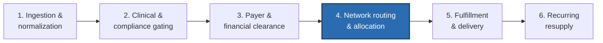
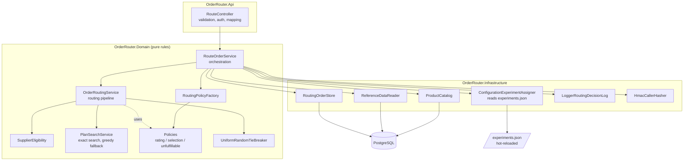
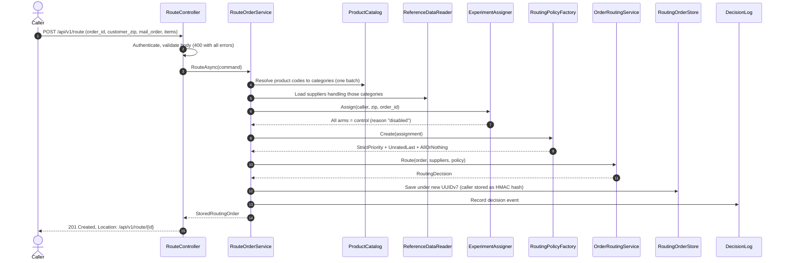
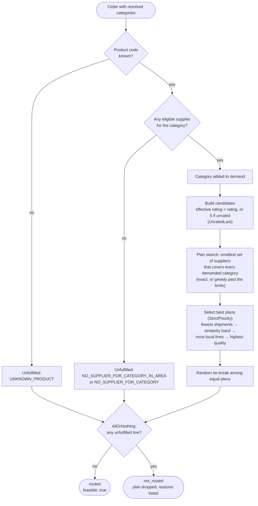
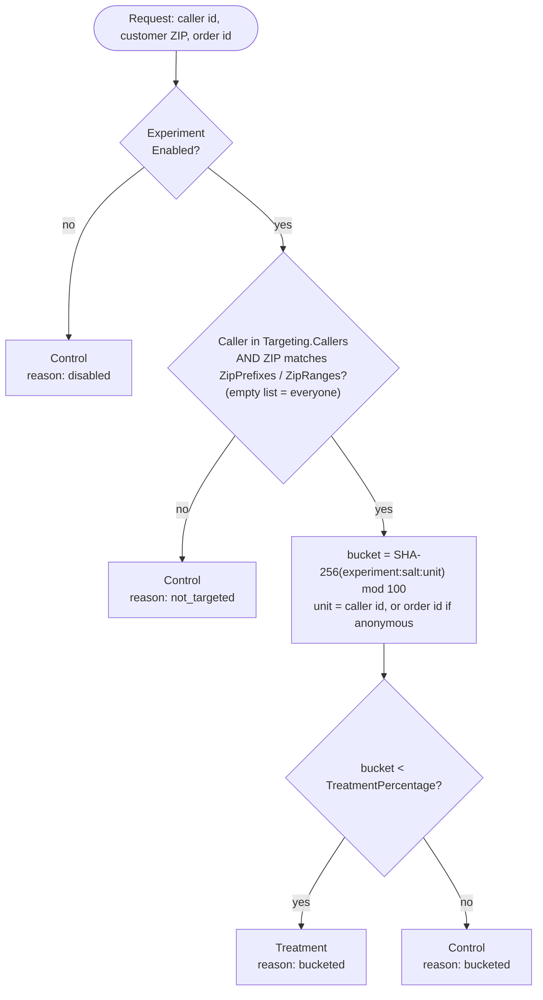
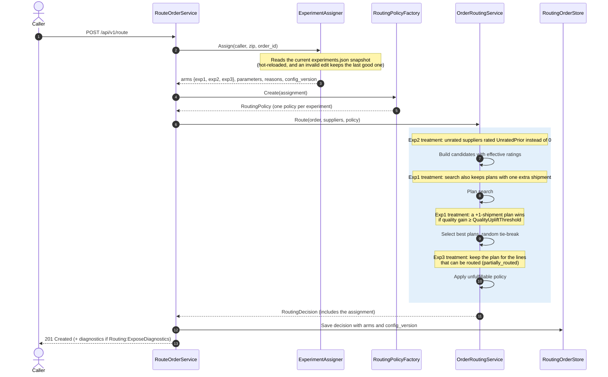

# order-router

Order Orchestration Engine for a DME healthcare logistics platform. It takes an order, assigns each line item to a supplier, and stores the decision so it can be read back.

## What this service does

A Durable Medical Equipment (DME) order, such as a wheelchair plus a portable oxygen concentrator, has to be fulfilled by a network of subcontracted suppliers. Each supplier handles some product categories, serves some ZIP codes, may ship by mail, and has a quality rating (or none yet). The order router picks **which supplier fulfils each line** of an order. It is stage 4 of the order lifecycle, *network routing & allocation*:



It does not own inventory, billing or fulfilment. It reads supplier and product reference data, decides, stores the decision under a new id, and returns it. The decision is stored before the answer is sent, so `GET` always returns exactly what the caller was told.

What a "good" routing is, in priority order:

1. **Fewest shipments.** Use as few suppliers as possible; all lines of one category go to the same supplier.
2. **Similar quality is equal quality.** Plans whose line-weighted mean rating is within `Routing:SimilarityBand` (default `0.5`) of the best plan count as equally good.
3. **Most local lines.** Among those, prefer suppliers that serve the customer's ZIP over shipping by mail.
4. **Highest quality.**
5. **Random tie-break.** If plans are still equal, pick one uniformly at random.

### Components



The Domain holds every business rule and does no I/O inside the routing pipeline. The Infrastructure loads data and configuration through the ports in `Domain/Interfaces`. Experiments never touch routing code directly: they only decide **which policy objects** the pipeline is given.

### Normal flow (experiments off)

This is what happens on every request while all experiments are disabled, which is the default in [experiments.json](src/OrderRouter.Api/experiments.json). Every request gets the control arm of all three experiments.



Inside `OrderRoutingService`, the routing pipeline for one order:



Eligibility rules are fixed and no experiment can change them:

- **Local order** (`mail_order: false`): the supplier must serve the customer's ZIP and must not be mail-only (a supplier covering the whole nationwide ZIP range).
- **Mail order** (`mail_order: true`): the supplier must be able to mail-order; the ZIP does not matter.
- A supplier ships **locally** when it serves the ZIP and is not mail-only, otherwise **by mail**.

### Flow with experiments on

Three experiments can each replace one policy in the pipeline. The pipeline itself does not change; only the policy objects plugged into it do.

#### Why each experiment exists

The stakeholder chose to A/B test three policy questions instead of fixing the answers up front ([Requirements §8](Docs/BusinessRequirements/Order-Router-Technical-Requirements.md), SC-01, SC-02, SC-04, SC-05).

- **EXP-1, consolidation vs. quality.** Two goals conflict: *"We want to do as few orders as possible but also care about ratings."* Sometimes the plan with the fewest shipments uses a weaker supplier. The question is whether it is worth adding a shipment to get a much better-rated supplier.
  - Control: fewer shipments always wins.
  - Treatment: one extra shipment is allowed, but only for a large quality gain. For example, with a threshold of 2.0, one shipment at quality 6.0 loses to two shipments at 9.0, but one shipment at 8.0 beats two at 9.0.
  - Why the treatment has a hard limit: if quality and shipment count were simply weighted against each other, an order could be split three or four ways to chase ratings, which breaks the "fewest orders" rule (BR-12).
  - Primary metric: customer satisfaction on delivered orders. Guard rails: average shipments per order, the share of single-shipment orders, the feasibility rate.
- **EXP-2, unrated suppliers.** A new supplier has no rating yet. Counted as 0, it loses to almost any rated supplier, so it never gets orders and never earns a rating. The stakeholder wants to *"give them a chance to get into our system."* The question is whether sending orders to new suppliers hurts outcomes.
  - Control: an unrated supplier counts as 0. It is still eligible, but it is chosen only when no rated supplier can do the job.
  - Treatment: an unrated supplier counts as a starting rating of 6.5 (`UnratedPrior`), so it competes with average suppliers instead of losing to all of them. In the seed data, 916 of 1,100 suppliers are rated: the mean rating is 7.10, the median 7.0 and the range 2.6 to 10. So 6.5 is about 0.6 below the mean, a slightly cautious starting point for a supplier with no history. It is a configurable default, not a computed value; it does not follow the data if the ratings change.
  - Primary metric: the share of orders routed to new suppliers, and the ratings they later earn. Guard rails: customer satisfaction, the complaint and return rates.
- **EXP-3, partial routing.** The original spec is all-or-nothing: if one item cannot be fulfilled, nothing is routed. The stakeholder's view is *"It is better to ship some items than to ship nothing."* In healthcare that change is risky, so it is tested instead of being switched on for everyone. The question is whether shipping what we can do better than holding the whole order.
  - Control: nothing is routed, and the response lists the items that could not be routed.
  - Treatment: the items that can be routed are routed and the rest are listed so a person can act on them. When [item-dependency rules](#item-dependency-rules) are configured, a routed item whose required companion was not fulfilled is flagged in `warnings` (SC-08).
  - Primary metrics: time to first delivery, the percentage of items delivered. Guard rails: orders later cancelled, patient complaints about incomplete orders, how often manual intervention is needed.

The router only records which arms each decision used (in the decision log event). It cannot measure satisfaction, deliveries or complaints itself. Those metrics need a downstream feedback loop joined on the stored order `id`, and that loop is not part of this service (§8.3).

#### How each experiment changes routing

| Experiment | Policy slot | Control (default) | Treatment |
|---|---|---|---|
| `Exp1ConsolidationVsQuality` | Plan selection | `StrictPriorityPolicy`: fewest shipments always wins. | `BoundedTradeOffPolicy`: the search also returns plans with **one** extra shipment; such a plan wins only if its quality is at least `QualityUpliftThreshold` (default `2.0`) above the plan control would pick. |
| `Exp2UnratedSuppliers` | Effective rating | `UnratedLastPolicy`: an unrated supplier counts as `0`. | `ColdStartPriorPolicy`: an unrated supplier counts as `UnratedPrior` (default `6.5`), so new suppliers can win orders. |
| `Exp3PartialRouting` | Unfulfillable lines | `AllOrNothingPolicy`: one unfulfillable line means nothing is routed. | `PartialRoutingPolicy`: route what can be routed, return `partially_routed` and list the rest in `unfulfilled_items`. |

First, each experiment independently decides the arm for the request:



The bucket is a stable hash, so the same caller always lands in the same arm, on every instance and after restarts. Each experiment has its own salt, so the three assignments are independent and any of the eight arm combinations can occur.

Then the arms decide which policies the pipeline runs with. The highlighted steps are the ones a treatment arm changes:



The arms, the reasons and the `config_version` are written with every decision event, so outcomes can be compared per arm. With `Routing:ExposeDiagnostics` turned on, they are also returned in the response's `diagnostics` object. How to turn experiments on is described in [Experiments](#experiments).

## Routing examples

These are real responses from the API running locally against the seeded data (`docker compose` plus `dotnet test`, see [Getting started](#getting-started)). They were captured on 2026-11-16 with `Routing:ExposeDiagnostics` turned on so the experiment arms are visible. Ratings come from [Docs/Data/Seed/suppliers.normalized.csv](Docs/Data/Seed/suppliers.normalized.csv). The `id` in each response is new on every `POST`.

How to read a response:

- Each entry in `routing` is **one shipment**: one supplier and the lines it fulfils. The number of shipments is the length of `routing`.
- `fulfillment_mode` is `local` when the supplier serves the customer's ZIP, otherwise `mail`.
- **Quality** below is the line-weighted mean rating of the chosen suppliers, the number the router compares between plans.

### Sample orders (all experiments off)

The three orders in [Docs/Data/sample_orders.json](Docs/Data/sample_orders.json):

| Order | ZIP, mode | Items (category) | Supplier per item | Shipments | Quality | Why |
|---|---|---|---|---|---|---|
| `ORD-001` | 10015, local | `WC-STD-001` (wheelchair), `OX-PORT-024` (oxygen) | Both: `SUP-0810` Pacific Prosthetics Express #810 (6.0), local | **1** | 6.0 | `SUP-0810` is the only local supplier that handles both categories. Better-rated specialists exist (wheelchair 7.1, oxygen 7.0), but fewest shipments wins. |
| `ORD-002` | 77059, local | `HB-FUL-018` (hospital bed), `PL-ELEC-043` (patient lift), `CM-BED-048` (commode), `BP-AUTO-077` (blood pressure monitor) | Bed, lift, commode: `SUP-0375` Allied Mobility Group #375 (9.2). BP monitor: `SUP-042` Metropolitan Medical Inc (9.0). All local | **2** | 9.15 | No local supplier handles all four categories, so two shipments is the minimum. Among the two-shipment plans this one has the highest quality. |
| `ORD-003` | 02130, mail | `CP-STD-031` (cpap), `CP-MSK-FF-035` ×2 (cpap), `NB-COMP-039` (nebulizer) | All: `SUP-023` Community Care Equipment (10.0), mail | **1** | 10.0 | Mail order, so the ZIP does not limit eligibility. `SUP-023` and `SUP-065` are both rated 10.0 and both ship by mail, a true tie. In 8 repeated calls each won 4 times (random tie-break, FR-13). |

Full response for `ORD-001`:

```json
{
  "id": "01a1e713-eb79-79cb-a176-6f2664320cc9",
  "order_id": "ORD-001",
  "feasible": true,
  "status": "routed",
  "routing": [
    {
      "supplier_id": "SUP-0810",
      "supplier_name": "Pacific Prosthetics Express #810",
      "items": [
        { "product_code": "WC-STD-001", "quantity": 1, "category": "wheelchair", "fulfillment_mode": "local" },
        { "product_code": "OX-PORT-024", "quantity": 1, "category": "oxygen", "fulfillment_mode": "local" }
      ]
    }
  ],
  "unfulfilled_items": [],
  "warnings": [],
  "errors": [],
  "diagnostics": {
    "experiment_arms": {
      "exp1_consolidation_vs_quality": { "arm": "control", "reason": "disabled" },
      "exp2_unrated_suppliers": { "arm": "control", "reason": "disabled" },
      "exp3_partial_routing": { "arm": "control", "reason": "disabled" }
    },
    "search_mode": "exact"
  }
}
```

### Experiments: control vs. treatment

Each order below was sent twice by the same caller: first with every experiment off (control), then with **one** experiment set to `Enabled: true, TreatmentPercentage: 100` in [experiments.json](src/OrderRouter.Api/experiments.json), using the default parameters. The file was hot-reloaded; no restart was needed.

#### EXP-1: consolidation vs. quality

Order: ZIP `02101`, local, `BB-LUM-090` (back brace) + `CP-STD-031` (cpap).

| Arm | Supplier per item | Shipments | Quality |
|---|---|---|---|
| Control | Both: `SUP-0955` FirstChoice Wellness Group #955 (4.8) | 1 | 4.8 |
| Treatment | Back brace: `SUP-0956` DME Equipment Inc #956 (7.8). CPAP: `SUP-065` Essential Medical Warehouse (10.0) | 2 | **8.9** |

Control always takes the single shipment, even from a 4.8-rated supplier. The treatment adds **one** shipment because quality rises by 4.1 points, above the `QualityUpliftThreshold` of 2.0.

The threshold also stops splits that are not worth it. `ORD-001` under the same treatment **stays at one shipment** with `SUP-0810` (6.0): its best two-shipment plan (7.1 and 7.0) gains only about 1.05 points.

**Benefit:** a patient with a CPAP and a back brace gets both from well-rated suppliers instead of one weak one, for one extra delivery. The experiment measures whether that improves satisfaction more than the extra shipment costs.

**More detail:** [ticket OR-017](Docs/Tickets/OR-017-exp1-bounded-tradeoff.md) · [integration tests](tests/OrderRouter.Api.IntegrationTests/Controllers/V1/BoundedTradeOffHostTests.cs) · [results on 125 orders](Docs/TestingAnalysis/routing_results.md#4-effect-by-experiment)

#### EXP-2: unrated suppliers

Order: ZIP `02101`, local, `CP-STD-031` (cpap) + `GL-STD-081` (glucose meter). Only two local suppliers handle both categories: `SUP-0955` (rated 4.8) and `SUP-0781` Sunrise Mobility Network #781 (no rating yet).

| Arm | Supplier per item | Shipments | Effective rating used |
|---|---|---|---|
| Control | Both: `SUP-0955` FirstChoice Wellness Group #955 | 1 | 4.8 vs. unrated counted as 0 |
| Treatment | Both: `SUP-0781` Sunrise Mobility Network #781 | 1 | 4.8 vs. unrated counted as **6.5** |

Same number of shipments either way. In control the new supplier loses to a below-average supplier only because it has no history. In the treatment its starting rating of 6.5 beats 4.8 by more than the 0.5 similarity band.

**Benefit:** 184 of the 1,100 seeded suppliers have no rating. Under control they only get orders when nobody rated can do the job, so most of them never earn a rating. The treatment gives them real orders in low-risk cases, so the network learns which new suppliers are good.

**More detail:** [ticket OR-018](Docs/Tickets/OR-018-exp2-cold-start-prior.md) · [unit tests](tests/OrderRouter.Tests/Domain/Services/ColdStartRoutingTests.cs) · [results on 125 orders](Docs/TestingAnalysis/routing_results.md#4-effect-by-experiment)

#### EXP-3: partial routing

Order: ZIP `10015`, local, `WC-STD-001` (wheelchair) + `OX-PORT-024` (oxygen) + `OX-CONC-999` (not in the catalog).

| Arm | `status` | Routed | Unfulfilled | Shipments |
|---|---|---|---|---|
| Control | `not_routed` | Nothing | `OX-CONC-999`: `UNKNOWN_PRODUCT` | 0 |
| Treatment | `partially_routed` | Wheelchair and oxygen: `SUP-0810` (6.0), local | `OX-CONC-999`: `UNKNOWN_PRODUCT` | 1 |

Treatment response (`id` and `diagnostics` omitted):

```json
{
  "order_id": "EXP3-DEMO",
  "feasible": false,
  "status": "partially_routed",
  "routing": [
    {
      "supplier_id": "SUP-0810",
      "supplier_name": "Pacific Prosthetics Express #810",
      "items": [
        { "product_code": "WC-STD-001", "quantity": 1, "category": "wheelchair", "fulfillment_mode": "local" },
        { "product_code": "OX-PORT-024", "quantity": 1, "category": "oxygen", "fulfillment_mode": "local" }
      ]
    }
  ],
  "unfulfilled_items": [
    {
      "product_code": "OX-CONC-999",
      "quantity": 1,
      "category": null,
      "reason_code": "UNKNOWN_PRODUCT",
      "message": "Product code 'OX-CONC-999' was not found in the catalog."
    }
  ],
  "warnings": [],
  "errors": []
}
```

**More detail:** [ticket OR-019](Docs/Tickets/OR-019-exp3-partial-routing.md) · [integration tests](tests/OrderRouter.Api.IntegrationTests/Controllers/V1/PartialRoutingApiTests.cs) · [results on 125 orders](Docs/TestingAnalysis/routing_results.md#4-effect-by-experiment)

**Benefit:** one bad line no longer blocks the whole order. The patient's wheelchair and oxygen can ship now, and only the unknown item goes to a person to fix. `feasible` stays `false`, so downstream systems still know the order is incomplete.

**With a dependency rule.** A partial route can split items that are clinically needed together. Configured [item-dependency rules](#item-dependency-rules) flag that case in `warnings`. The seeded suppliers cover every category in every real ZIP, so this example uses the test-only sentinel ZIP `00098`. There, `SUP-T014` handles wheelchairs only, so a walker cannot be fulfilled. With the illustrative rule `wheelchair` requires `walker` and EXP-3 in treatment, `WC-STD-001` + `WK-STD-009` returns (`id` omitted):

```json
{
  "order_id": "DEP-DEMO",
  "feasible": false,
  "status": "partially_routed",
  "routing": [
    {
      "supplier_id": "SUP-T014",
      "supplier_name": "Sentinel No-Coverage Control",
      "items": [
        { "product_code": "WC-STD-001", "quantity": 1, "category": "wheelchair", "fulfillment_mode": "local" }
      ]
    }
  ],
  "unfulfilled_items": [
    {
      "product_code": "WK-STD-009",
      "quantity": 1,
      "category": "walker",
      "reason_code": "NO_SUPPLIER_FOR_CATEGORY_IN_AREA",
      "message": "No supplier delivers 'walker' to the delivery ZIP."
    }
  ],
  "warnings": [
    {
      "code": "DEPENDENT_ITEM_UNFULFILLED",
      "message": "WC-STD-001 (wheelchair) is routed, but its required companion WK-STD-009 (walker) could not be fulfilled. Review before releasing.",
      "unfulfilled_product_codes": ["WK-STD-009"],
      "affected_product_codes": ["WC-STD-001"]
    }
  ],
  "errors": ["No supplier delivers 'walker' to the delivery ZIP."]
}
```

The wheelchair still ships, and the warning tells the reviewer it should not be released without the walker. The rule changed nothing in `routing`; it only added the warning. The `GET` of the same `id` returns the same warning. An unknown product (like `OX-CONC-999` above) has no category, so it never triggers a rule.

### Summary

| Scenario | Control | Treatment | What changed |
|---|---|---|---|
| EXP-1 (02101, back brace + cpap) | 1 shipment, quality 4.8 | 2 shipments, quality 8.9 | +1 shipment for +4.1 quality |
| EXP-1 (`ORD-001`) | 1 shipment, quality 6.0 | 1 shipment, quality 6.0 | Nothing: gain below threshold |
| EXP-2 (02101, cpap + glucose meter) | Rated supplier at 4.8 | New, unrated supplier | New supplier gets an order |
| EXP-3 (10015, 2 known + 1 unknown item) | 0 of 3 items routed | 2 of 3 items routed | Known items ship now |

### Experiment tests and results

Where to find the detail behind each experiment. The examples above are single orders; the links below cover every arm combination and a larger run.

| Experiment | Ticket | Tests | Results |
|---|---|---|---|
| EXP-1 consolidation vs. quality | [OR-017](Docs/Tickets/OR-017-exp1-bounded-tradeoff.md) | [BoundedTradeOffHostTests](tests/OrderRouter.Api.IntegrationTests/Controllers/V1/BoundedTradeOffHostTests.cs) | [Effect by experiment](Docs/TestingAnalysis/routing_results.md#4-effect-by-experiment) |
| EXP-2 unrated suppliers | [OR-018](Docs/Tickets/OR-018-exp2-cold-start-prior.md) | [ColdStartRoutingTests](tests/OrderRouter.Tests/Domain/Services/ColdStartRoutingTests.cs) | [Effect by experiment](Docs/TestingAnalysis/routing_results.md#4-effect-by-experiment) |
| EXP-3 partial routing | [OR-019](Docs/Tickets/OR-019-exp3-partial-routing.md), [OR-020](Docs/Tickets/OR-020-dependency-warnings.md) | [PartialRoutingApiTests](tests/OrderRouter.Api.IntegrationTests/Controllers/V1/PartialRoutingApiTests.cs), [DependencyWarningsApiTests](tests/OrderRouter.Api.IntegrationTests/Controllers/V1/DependencyWarningsApiTests.cs) | [Effect by experiment](Docs/TestingAnalysis/routing_results.md#4-effect-by-experiment) |
| Assignment and bucketing (all) | [OR-016](Docs/Tickets/OR-016-experiment-assignment.md) | [ExperimentAssignmentHostTests](tests/OrderRouter.Api.IntegrationTests/Controllers/V1/ExperimentAssignmentHostTests.cs), [ExperimentArmsHostTests](tests/OrderRouter.Api.IntegrationTests/Controllers/V1/ExperimentArmsHostTests.cs), [ConfigurationExperimentAssignerTests](tests/OrderRouter.Tests/Infrastructure/Services/ConfigurationExperimentAssignerTests.cs), [ExperimentBucketerTests](tests/OrderRouter.Tests/Domain/Helpers/ExperimentBucketerTests.cs) | [ADR-0005](Docs/ADRs/ADR-0005-experiment-assignment.md) |
| All 8 arm combinations | [OR-024](Docs/Tickets/OR-024-experiment-combination-matrix.md) | [ExperimentCombinationMatrixTests](tests/OrderRouter.Api.IntegrationTests/Controllers/V1/ExperimentCombinationMatrixTests.cs) | [`scripts/run-tests.sh` output](#test-run-with-saved-results) (`responses/experiments/combinations/`) |
| Everything off equals the spec | [OR-023](Docs/Tickets/OR-023-acceptance-tests.md) | [AllControlEqualsAcceptanceTests](tests/OrderRouter.Api.IntegrationTests/Controllers/V1/AllControlEqualsAcceptanceTests.cs), [SampleOrderAcceptanceTests](tests/OrderRouter.Api.IntegrationTests/Controllers/V1/SampleOrderAcceptanceTests.cs) | [Sample orders](#sample-orders-all-experiments-off) |

Control vs. treatment over all 125 orders (sample plus production-like): [Docs/TestingAnalysis/routing_results.md](Docs/TestingAnalysis/routing_results.md). It has [key findings](Docs/TestingAnalysis/routing_results.md#1-key-findings), [headline metrics](Docs/TestingAnalysis/routing_results.md#3-headline-metrics), [caveats](Docs/TestingAnalysis/routing_results.md#5-caveats-for-interpreting-the-numbers) and [every order](Docs/TestingAnalysis/routing_results.md#appendix-b-every-order). Raw responses: [routing_results.json](Docs/TestingAnalysis/routing_results.json).

Everything below is for local development only.

## Prerequisites

- The .NET 10 SDK (the Docker image uses 10.0.404).
- Docker with Docker Compose.

## Getting started

Run these from the repository root, in this order.

1. Copy the dev-only settings: `cp .env.example .env`

   `.env` holds the dev API key (`DEV_API_KEY`, default `dev-only-change-me`). Every request to the API must send it in the `X-Api-Key` header; a missing or wrong key returns `401`. Compose passes it to the API as `Authentication__DevApiKey`, and it only works when `ASPNETCORE_ENVIRONMENT=Development` (see [Authentication](#authentication)). If you run the API with `dotnet run` instead of Docker, set it with `dotnet user-secrets set "Authentication:DevApiKey" "dev-only-change-me" --project src/OrderRouter.Api`.
2. Start PostgreSQL and the API:

   ```bash
   docker compose up -d --build --wait
   ```

   The API listens on `http://localhost:8080` (change it with `API_PORT` in `.env`). `--wait` can return a second or two before the API accepts requests; if the next call is refused, try again.
3. Run the tests. **This step is required.**

   ```bash
   dotnet test
   ```

   Neither `docker compose` nor the API creates the database schema or loads the reference data. Only the integration tests do (they apply the migrations and seed suppliers and products, [SC-33](Docs/BusinessRequirements/Order-Router-Technical-Requirements.md)). Until they have run, `POST` and `GET` on the routing endpoints return `500`, even though `GET /health` says `Healthy`, because `/health` only checks that PostgreSQL is reachable. The tests use the same database as the API, so running them prepares the API's database.
4. Route the order `ORD-001` from `Docs/Data/sample_orders.json`. The dev key comes from `DEV_API_KEY` in `.env`:

   ```bash
   curl -i -X POST http://localhost:8080/api/v1/route \
     -H "X-Api-Key: dev-only-change-me" \
     -H "Content-Type: application/json" \
     -d '{"order_id":"ORD-001","customer_zip":"10015","mail_order":false,"items":[{"product_code":"WC-STD-001","quantity":1},{"product_code":"OX-PORT-024","quantity":1}]}'
   ```

   You get `201 Created`, a `Location` header such as `/api/v1/route/01a1e702-39d4-7286-a7fc-e48b6201faea`, and a body with `"status":"routed"`, `"feasible":true` and supplier `SUP-0810` for both items.
5. Read it back with the `Location` value from step 4:

   ```bash
   curl -i http://localhost:8080/api/v1/route/<id> -H "X-Api-Key: dev-only-change-me"
   ```

   You get `200 OK` with the stored order and the same decision.

To stop everything, run `docker compose down`. To also delete the local database (you must then run `dotnet test` again), run `docker compose down -v`. `./localsetup.sh` runs `docker compose down` and then `docker compose up -d --wait`.

`/health` only checks that PostgreSQL is reachable, so an empty database is healthy. If PostgreSQL is not reachable when the API starts, the API exits with an error. In Development the OpenAPI document is at `http://localhost:8080/openapi/v1.json`.

## Build and test

```bash
dotnet build
dotnet test
```

- `tests/OrderRouter.Tests` holds the unit and architecture tests. It does not need a database.
- `tests/OrderRouter.Api.IntegrationTests` holds the endpoint and persistence tests. It needs PostgreSQL (`docker compose up -d postgres` is enough) and seeds it before the first test.
- By default the integration tests connect to the compose database: `Host=localhost;Port=5432;Database=orderrouter;Username=orderrouter;Password=orderrouter-dev-only`. To use another database, set the `ConnectionStrings__OrderRouter` environment variable. If PostgreSQL is not reachable the test run fails; it is never skipped.
- To run one project: `dotnet test --project tests/OrderRouter.Tests` or `dotnet test --project tests/OrderRouter.Api.IntegrationTests`.

### Test run with saved results

`scripts/run-tests.sh` runs both test projects from the command line and keeps the results in `test-results/run-<timestamp>/` (git-ignored; `test-results/latest` links to the newest run). It starts PostgreSQL through `docker compose` unless you pass `--no-db`, and `--only unit|integration` runs one project. The exit code is `0` only when every test passed.

- `summary.md`: one row per recorded response (HTTP status, order status, suppliers, experiment arms).
- `responses/default-route/`: the three sample orders with every experiment off.
- `responses/experiments/exp1|exp2|exp3/`: control and treatment of each experiment, side by side, each with the `experiments.json` it ran with. `responses/experiments/combinations/` has all 8 arm combinations over the four sentinel orders.
- `responses/all-tests/`: every response captured by the acceptance tests.
- `unit-tests.*` and `integration-tests.*` (`.trx` and `.html`): the pass/fail result of every test.

Responses are recorded only when `ORDERROUTER_RESULTS_DIR` is set, which the script does; a plain `dotnet test` writes nothing.

## Configuration

The caller is stored only as an HMAC hash, so the API needs a secret. Without it the API refuses to start.

- **Docker:** `CALLER_HASHING_SECRET` in `.env` (the `.env.example` value is a dev-only placeholder). If you copied `.env.example` before this setting existed, add the line to your `.env` and run `docker compose up -d --force-recreate api`.
- **`dotnet run`:** `dotnet user-secrets set "CallerHashing:Secret" "<value>" --project src/OrderRouter.Api`

## Regenerating the seed data

The API never reads the raw CSVs. It reads the database, which the tests fill from the committed files in `Docs/Data/Seed`. Regenerate those files only when `Docs/Data/suppliers.csv` or `Docs/Data/products.csv` change:

```bash
dotnet run --project tools/OrderRouter.DataNormalizer
```

- It reads `Docs/Data` and writes `Docs/Data/Seed`. Use `--input <dir>` and `--output <dir>` to change either.
- It logs each skipped row with its row number and reason, and each duplicate product it removed (the first row is kept), then a count per file.
- Exit code is `0` on success and `1` on failure. On failure nothing is written.
- The output is deterministic: with unchanged CSVs, the files in `Docs/Data/Seed` do not change.
- After a change, commit the new files and run `dotnet test` again to load them. The seed is an upsert: it adds and updates rows but never deletes rows that were removed from the CSVs.

## Authentication

Every endpoint except `GET /health` (and, in Development, the OpenAPI document and `/scalar`) requires authentication. A missing or invalid credential returns `401` with a `WWW-Authenticate: Bearer` header, before anything else is checked.

- **Production:** send a JWT bearer token (`Authorization: Bearer <token>`). Configure `Authentication:Jwt:Authority` and `Authentication:Jwt:Audience`; the API refuses to start outside Development without them.
- **Development only:** send the key from `DEV_API_KEY` (see `.env.example`) in the `X-Api-Key` header. It is read from `Authentication:DevApiKey` (environment variable or `dotnet user-secrets`), never from a committed file, and is ignored in any other environment.

## API

JSON property names are `snake_case`. Unknown request fields are ignored. In Development, the full contract with examples is in the OpenAPI document (`/openapi/v1.json`) and the Scalar UI (`/scalar`).

| Method and path | Purpose |
|---|---|
| `POST /api/v1/route` | Route an order and store the decision. |
| `POST /api/route` | Alias of the endpoint above, pinned to v1 (see [Behaviour notes](#behaviour-notes)). |
| `GET /api/v1/route/{id}` | Read back a stored order, exactly as decided. |
| `GET /health` | Anonymous. Plain text `Healthy` (`200`) or `Unhealthy` (`503`): checks only that PostgreSQL is reachable. |

Request body of `POST`:

| Field | Rule |
|---|---|
| `order_id` | Required, not blank. |
| `customer_zip` | Required, exactly 5 digits. |
| `mail_order` | Optional, defaults to `false`. |
| `items` | Required, at least one item: `product_code` (required) and `quantity` (required, at least 1). |

### Status codes

This differs from the original spec, which answered `200` for everything ([DEV-07, DEV-14](Docs/BusinessRequirements/Order-Router-Technical-Requirements.md)). Each outcome now has its own HTTP status.

| Status | When | Body |
|---|---|---|
| `201 Created` | `POST` with a valid request, including when the order could not be routed. | The routing decision, with the new `id`. The `Location` header is `/api/v1/route/{id}`, also for the alias. |
| `200 OK` | `GET /api/v1/route/{id}` for an order the caller created. | The stored request and the same decision. |
| `400 Bad Request` | `POST` with an invalid or malformed body. | The routing envelope with `"status":"not_routed"`, `"feasible":false` and every validation error in `errors`, all at once. |
| `401 Unauthorized` | No credential, or an invalid one. | `WWW-Authenticate` header. |
| `404 Not Found` | `GET` of an `id` that does not exist, is not a UUID, or belongs to another caller. | One identical Problem Details response for all three, so existence is never revealed. |
| `500 Internal Server Error` | An unexpected fault, for example the database schema is missing (see [Getting started](#getting-started)). | Problem Details with no internal details. |

"Could not route" is a business outcome, not an error. A valid order for an unknown product returns `201` with `"feasible":false`, `"status":"not_routed"` and the reason in `unfulfilled_items`. `status` is `routed`, `partially_routed` or `not_routed`, and `feasible` is `true` only for `routed`.

Example of a `400`:

```bash
curl -i -X POST http://localhost:8080/api/v1/route \
  -H "X-Api-Key: dev-only-change-me" -H "Content-Type: application/json" \
  -d '{"order_id":"ORD-BAD","items":[]}'
```

```json
{"feasible":false,"status":"not_routed","routing":[],"unfulfilled_items":[],"warnings":[],"errors":["customer_zip is required.","items must contain at least one item."]}
```

## Behaviour notes

- **Ties are random.** When several supplier plans are equal on every rule, one is picked uniformly at random ([FR-13](Docs/BusinessRequirements/Order-Router-Technical-Requirements.md)). Sending the same order again can therefore give a different supplier. The first response is the authoritative one: it is the one stored and returned by `GET`. When there is no tie, the same input always gives the same result.
- **`/api/route` is pinned to v1.** It is a `POST`-only alias with the same handler, validation and contract as `/api/v1/route`, and it never changes. There is no `GET` under `/api/route`. New callers should use `/api/v1/route` ([ADR-0004](Docs/ADRs/ADR-0004-response-contract-evolution.md)).
- **Every POST is a new order.** Each `POST`, retries included, is stored under a new server-generated `id` (UUIDv7). Nothing is de-duplicated by `order_id`. Only the caller that created an order can read it back; anyone else gets `404` ([ADR-0007](Docs/ADRs/ADR-0007-routing-decision-persistence.md)). The caller is stored only as an HMAC hash.
- **Diagnostics are optional.** With `Routing:ExposeDiagnostics` set to `true`, the `201` and `GET` bodies also carry a `diagnostics` object (experiment arms and search mode). It is `false` by default, is read at startup (a change needs a restart), and clients must not depend on it.

## Experiments

Three experiments can change routing for a share of callers. They are configured in [src/OrderRouter.Api/experiments.json](src/OrderRouter.Api/experiments.json) and all start **disabled**. See [ADR-0005](Docs/ADRs/ADR-0005-experiment-assignment.md) for how callers are assigned.

| Key | What the treatment does | Parameter |
|---|---|---|
| `Exp1ConsolidationVsQuality` | Allows one extra shipment when the quality gain is large enough. | `QualityUpliftThreshold` |
| `Exp2UnratedSuppliers` | Gives unrated suppliers a starting rating. | `UnratedPrior` |
| `Exp3PartialRouting` | Routes the items it can instead of failing the whole order. | none |

For each experiment:

- `Enabled`: `true` turns it on, `false` turns it off. A disabled experiment always uses the control behaviour.
- `TreatmentPercentage`: 0 to 100, the share of targeted callers in the treatment arm. `Salt` must not be empty; each experiment has its own, so assignments are independent.
- `Targeting`: limits who is eligible. `Callers` lists caller IDs, `ZipPrefixes` lists ZIP prefixes of 1 to 5 digits, and `ZipRanges` lists inclusive ranges such as `"10000-14999"`. An empty list means everyone.
- `Routing:SimilarityBand` in the same file is reloaded with the rest.
- `Exp2UnratedSuppliers.Parameters.UnratedPrior` (1 to 10, default `6.5`): the rating an unrated supplier counts as in the treatment arm. The seed data has a mean rating of 7.10 and a median of 7.0 across 916 rated suppliers (184 are unrated), so 6.5 sits slightly below average. Raise it to give new suppliers more orders; lower it to be more cautious. The value is only a ranking stand-in and is never stored as the supplier's rating.

Changes apply without a restart or a deploy:

- Edit the file and save. The API picks up the change within a few seconds (under Docker it polls for changes).
- **Under Docker, edit the file in place.** It is mounted into the container as a single file, which follows the file's inode. An editor or command that replaces the file (for example `sed -i`, or an editor that writes a temp file and renames it) detaches the mount until the container is recreated (`docker compose up -d --force-recreate api`).
- **An invalid edit is rejected.** The API logs an error (`Experiment configuration rejected; keeping the last known good ...`) and keeps serving the last valid configuration. An invalid file at startup stops the API from starting.
- Other `Routing` settings, such as `NationwideZipRange` and `ExposeDiagnostics`, are not reloaded.

Example: turn on `Exp3PartialRouting` for everyone.

```json
"Exp3PartialRouting": {
  "Enabled": true,
  "TreatmentPercentage": 100,
  "Salt": "exp3",
  "Targeting": { "Callers": [], "ZipPrefixes": [], "ZipRanges": [] }
}
```

## Item-dependency rules

A rule says that items of one category are clinically needed together with items of other categories ([SC-08, SC-11, FR-18](Docs/BusinessRequirements/Order-Router-Technical-Requirements.md), [OR-020](Docs/Tickets/OR-020-dependency-warnings.md)). On a `partially_routed` order, each rule whose category has a routed item and whose required category has an unfulfilled item adds one `DEPENDENT_ITEM_UNFULFILLED` entry to `warnings`. The entry names the unfulfilled product codes and the routed (affected) ones.

**No rules ship with the service.** The `ItemDependencies:Rules` list in [appsettings.json](src/OrderRouter.Api/appsettings.json) is empty, so `warnings` is always empty until rules are added. The real rule set is clinical content, owned by clinical operations rather than engineering (DR-03, DR-05). Example, for illustration only:

```json
"ItemDependencies": {
  "Rules": [
    { "Category": "hospital bed", "Requires": [ "patient lift" ] }
  ]
}
```

Or, as environment variables (for example in `docker compose`):

```bash
ItemDependencies__Rules__0__Category="hospital bed"
ItemDependencies__Rules__0__Requires__0="patient lift"
```

- Rules are one-way and category-level. Category names are matched ignoring case and surrounding spaces.
- Rules only add warnings. They never change eligibility, ranking or the `routing` section (DR-04).
- Warnings appear only on `partially_routed` orders. Under the EXP-3 control arm an order with an unfulfilled item is `not_routed`, so nothing is affected.
- An unknown product has no category, so it never matches a rule.
- The rules are read at startup; a change needs a restart.
- **A malformed rule stops the API from starting.** That means an empty category name, no required category, a rule that requires its own category, or two rules for one category. The error names the bad key, for example `ItemDependencies:Rules:0:Category must not be empty.` Startup checks only the shape and never reads the database (DR-02).
- A rule naming a category that is not in the reference data is skipped at routing time, with a logged warning: `Item-dependency rule for '<category>' was skipped: ...` The request still succeeds.

## Further reading

- [Requirements](Docs/BusinessRequirements/Order-Router-Technical-Requirements.md)
- [Experiment results: control vs. treatment](Docs/TestingAnalysis/routing_results.md) and the [experiment test index](#experiment-tests-and-results)
- [Architecture decision records](Docs/ADRs/README.md)
- [Tickets](Docs/Tickets/README.md)
- [AI prompts used to build this service](Docs/AI_PROMPTS.md)
