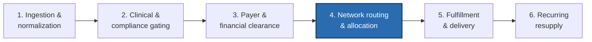
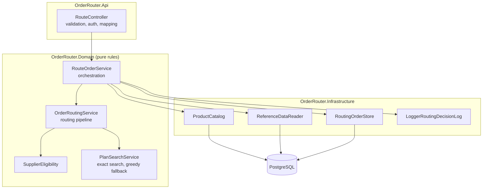
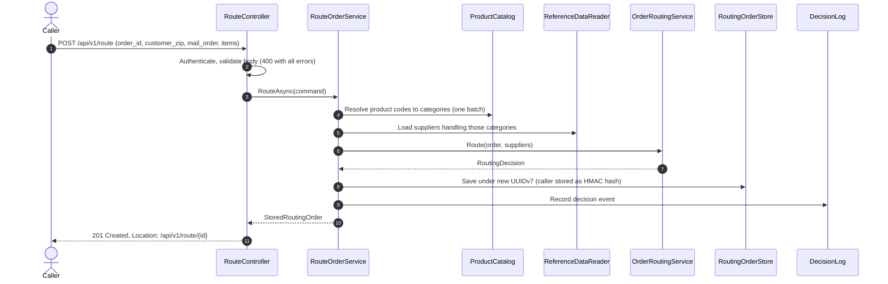
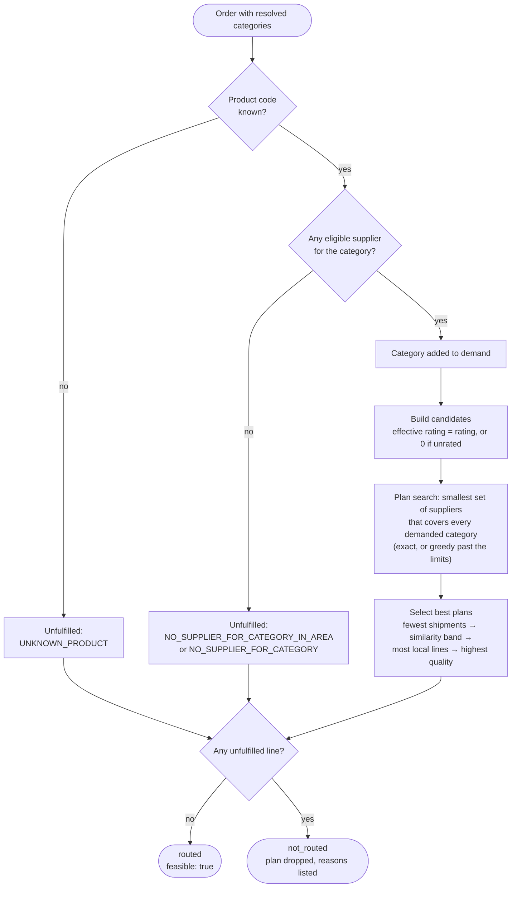

# order-router

Order Orchestration Engine for a DME healthcare logistics platform. It takes an order, assigns each line item to a supplier, and stores the decision so it can be read back.

## What this service does

A Durable Medical Equipment (DME) order, such as a wheelchair plus a portable oxygen concentrator, has to be fulfilled by a network of subcontracted suppliers. Each supplier handles some product categories, serves some ZIP codes, may ship by mail, and has a quality rating (or none yet). The order router picks **which supplier fulfils each line** of an order. It is stage 4 of the order lifecycle, *network routing & allocation*:



It does not own inventory, billing or fulfilment. It reads supplier and product reference data, decides, stores the decision under a new id, and returns it. The decision is stored before the answer is sent, so `GET` always returns exactly what the caller was told.

What a "good" routing is, in priority order:

1. **Fewest shipments.** Use as few suppliers as possible; all lines of one category go to the same supplier.
2. **Similar quality is equal quality.** Plans whose line-weighted mean rating is within `Routing:SimilarityBand` (default `0.5`) of the best plan count as equally good.
3. **Most local lines.** Among those, prefer suppliers that serve the customer's ZIP over shipping by mail.
4. **Highest quality.**

### Components



The Domain holds every business rule and does no I/O inside the routing pipeline. The Infrastructure loads data through the ports in `Domain/Interfaces`.

### Request flow



Inside `OrderRoutingService`, the routing pipeline for one order:



Eligibility rules are fixed:

- **Local order** (`mail_order: false`): the supplier must serve the customer's ZIP and must not be mail-only (a supplier covering the whole nationwide ZIP range).
- **Mail order** (`mail_order: true`): the supplier must be able to mail-order; the ZIP does not matter.
- A supplier ships **locally** when it serves the ZIP and is not mail-only, otherwise **by mail**.

### Experiments

Four optional A/B experiments on the routing policies (plan selection, unrated suppliers, partial routing and tie-breaking) are all disabled by default and are not part of the flow above. See [Docs/Experiments.md](Docs/Experiments.md).

## Routing examples


These are real responses from the API running locally against the seeded data (`docker compose` plus `dotnet test`, see [Getting started](#getting-started)). They were captured on 2026-11-16. Ratings come from [Docs/Data/Seed/suppliers.normalized.csv](Docs/Data/Seed/suppliers.normalized.csv). The `id` in each response is new on every `POST`.

How to read a response:

- Each entry in `routing` is **one shipment**: one supplier and the lines it fulfils. The number of shipments is the length of `routing`.
- `fulfillment_mode` is `local` when the supplier serves the customer's ZIP, otherwise `mail`.
- **Quality** below is the line-weighted mean rating of the chosen suppliers, the number the router compares between plans.

### Sample orders (all experiments off)

The three orders in [Docs/Data/sample_orders.json](Docs/Data/sample_orders.json):

| Order | ZIP, mode | Items (category) | Supplier per item | Shipments | Quality | Why |
|---|---|---|---|---|---|---|
| `ORD-001` | 10015, local | `WC-STD-001` (wheelchair), `OX-PORT-024` (oxygen) | Both: `SUP-0810` Pacific Prosthetics Express #810 (6.0), local | **1** | 6.0 | `SUP-0810` is the only local supplier that handles both categories. Better-rated specialists exist (wheelchair 7.1, oxygen 7.0), but fewest shipments wins. |
| `ORD-002` | 77059, local | `HB-FUL-018` (hospital bed), `PL-ELEC-043` (patient lift), `CM-BED-048` (commode), `BP-AUTO-077` (blood pressure monitor) | Bed, lift, commode: `SUP-0375` Allied Mobility Group #375 (9.2). BP monitor: `SUP-042` Metropolitan Medical Inc (9.0). All local | **2** | 9.15 | No local supplier handles all four categories, so two shipments is the minimum. Among the two-shipment plans this one has the highest quality. |
| `ORD-003` | 02130, mail | `CP-STD-031` (cpap), `CP-MSK-FF-035` ×2 (cpap), `NB-COMP-039` (nebulizer) | All: `SUP-023` Community Care Equipment (10.0), mail | **1** | 10.0 | Mail order, so the ZIP does not limit eligibility. `SUP-023` and `SUP-065` are both rated 10.0 and both ship by mail, a true tie. By default the lowest supplier ID (`SUP-023`) wins every time; under the `Exp4TieBreaking` treatment either one can win. |

Full response for `ORD-001`:

```json
{
  "id": "01a1e713-eb79-79cb-a176-6f2664320cc9",
  "order_id": "ORD-001",
  "feasible": true,
  "status": "routed",
  "routing": [
    {
      "supplier_id": "SUP-0810",
      "supplier_name": "Pacific Prosthetics Express #810",
      "items": [
        { "product_code": "WC-STD-001", "quantity": 1, "category": "wheelchair", "fulfillment_mode": "local" },
        { "product_code": "OX-PORT-024", "quantity": 1, "category": "oxygen", "fulfillment_mode": "local" }
      ]
    }
  ],
  "unfulfilled_items": [],
  "warnings": [],
  "errors": []
}
```

### Experiment examples

Control vs. treatment examples for each experiment, with their results and tests, are in [Docs/Experiments.md](Docs/Experiments.md#experiments-control-vs-treatment).

## Load testing

Load tests with k6 for `POST /api/v1/route`, with default routing and with all experiments on, are in [loadtests/README.md](loadtests/README.md).


Everything below is for local development only.

## Prerequisites

- The .NET 10 SDK (the Docker image uses 10.0.404).
- Docker with Docker Compose.

## Getting started

Run these from the repository root, in this order.

1. Copy the dev-only settings: `cp .env.example .env`

   `.env` holds the dev API key (`DEV_API_KEY`, default `dev-only-change-me`). Every request to the API must send it in the `X-Api-Key` header; a missing or wrong key returns `401`. Compose passes it to the API as `Authentication__DevApiKey`, and it only works when `ASPNETCORE_ENVIRONMENT=Development` (see [Authentication](#authentication)). If you run the API with `dotnet run` instead of Docker, set it with `dotnet user-secrets set "Authentication:DevApiKey" "dev-only-change-me" --project src/OrderRouter.Api`.
2. Start PostgreSQL and the API:

   ```bash
   docker compose up -d --build --wait
   ```

   The API listens on `http://localhost:8080` (change it with `API_PORT` in `.env`). `--wait` can return a second or two before the API accepts requests; if the next call is refused, try again.
3. Run the tests. **This step is required.**

   ```bash
   dotnet test
   ```

   Neither `docker compose` nor the API creates the database schema or loads the reference data. Only the integration tests do (they apply the migrations and seed suppliers and products, [SC-33](Docs/BusinessRequirements/Order-Router-Technical-Requirements.md)). Until they have run, `POST` and `GET` on the routing endpoints return `500`, even though `GET /health` says `Healthy`, because `/health` only checks that PostgreSQL is reachable. The tests use the same database as the API, so running them prepares the API's database.
4. Route the order `ORD-001` from `Docs/Data/sample_orders.json`. The dev key comes from `DEV_API_KEY` in `.env`:

   ```bash
   curl -i -X POST http://localhost:8080/api/v1/route \
     -H "X-Api-Key: dev-only-change-me" \
     -H "Content-Type: application/json" \
     -d '{"order_id":"ORD-001","customer_zip":"10015","mail_order":false,"items":[{"product_code":"WC-STD-001","quantity":1},{"product_code":"OX-PORT-024","quantity":1}]}'
   ```

   You get `201 Created`, a `Location` header such as `/api/v1/route/01a1e702-39d4-7286-a7fc-e48b6201faea`, and a body with `"status":"routed"`, `"feasible":true` and supplier `SUP-0810` for both items.
5. Read it back with the `Location` value from step 4:

   ```bash
   curl -i http://localhost:8080/api/v1/route/<id> -H "X-Api-Key: dev-only-change-me"
   ```

   You get `200 OK` with the stored order and the same decision.

To stop everything, run `docker compose down`. To also delete the local database (you must then run `dotnet test` again), run `docker compose down -v`. `./localsetup.sh` runs `docker compose down` and then `docker compose up -d --wait`.

`/health` only checks that PostgreSQL is reachable, so an empty database is healthy. If PostgreSQL is not reachable when the API starts, the API exits with an error. In Development the OpenAPI document is at `http://localhost:8080/openapi/v1.json`.

## Build and test

```bash
dotnet build
dotnet test
```

- `tests/OrderRouter.Tests` holds the unit and architecture tests. It does not need a database.
- `tests/OrderRouter.Api.IntegrationTests` holds the endpoint and persistence tests. It needs PostgreSQL (`docker compose up -d postgres` is enough) and seeds it before the first test.
- By default the integration tests connect to the compose database: `Host=localhost;Port=5432;Database=orderrouter;Username=orderrouter;Password=orderrouter-dev-only`. To use another database, set the `ConnectionStrings__OrderRouter` environment variable. If PostgreSQL is not reachable the test run fails; it is never skipped.
- To run one project: `dotnet test --project tests/OrderRouter.Tests` or `dotnet test --project tests/OrderRouter.Api.IntegrationTests`.

### Test run with saved results

`scripts/run-tests.sh` runs both test projects from the command line and keeps the results in `test-results/run-<timestamp>/` (git-ignored; `test-results/latest` links to the newest run). It starts PostgreSQL through `docker compose` unless you pass `--no-db`, and `--only unit|integration` runs one project. The exit code is `0` only when every test passed.

- `summary.md`: one row per recorded response (HTTP status, order status, suppliers, experiment arms).
- `responses/default-route/`: the three sample orders with every experiment off.
- `responses/experiments/exp1|exp2|exp3/`: control and treatment of each experiment, side by side, each with the `experiments.json` it ran with. `responses/experiments/combinations/` has all 8 arm combinations over the four sentinel orders.
- `responses/all-tests/`: every response captured by the acceptance tests.
- `unit-tests.*` and `integration-tests.*` (`.trx` and `.html`): the pass/fail result of every test.

Responses are recorded only when `ORDERROUTER_RESULTS_DIR` is set, which the script does; a plain `dotnet test` writes nothing.

## Configuration

The caller is stored only as an HMAC hash, so the API needs a secret. Without it the API refuses to start.

- **Docker:** `CALLER_HASHING_SECRET` in `.env` (the `.env.example` value is a dev-only placeholder). If you copied `.env.example` before this setting existed, add the line to your `.env` and run `docker compose up -d --force-recreate api`.
- **`dotnet run`:** `dotnet user-secrets set "CallerHashing:Secret" "<value>" --project src/OrderRouter.Api`

## Regenerating the seed data

The API never reads the raw CSVs. It reads the database, which the tests fill from the committed files in `Docs/Data/Seed`. Regenerate those files only when `Docs/Data/suppliers.csv` or `Docs/Data/products.csv` change:

```bash
dotnet run --project tools/OrderRouter.DataNormalizer
```

- It reads `Docs/Data` and writes `Docs/Data/Seed`. Use `--input <dir>` and `--output <dir>` to change either.
- It logs each skipped row with its row number and reason, and each duplicate product it removed (the first row is kept), then a count per file.
- Exit code is `0` on success and `1` on failure. On failure nothing is written.
- The output is deterministic: with unchanged CSVs, the files in `Docs/Data/Seed` do not change.
- After a change, commit the new files and run `dotnet test` again to load them. The seed is an upsert: it adds and updates rows but never deletes rows that were removed from the CSVs.

## Authentication

Every endpoint except `GET /health` (and, in Development, the OpenAPI document and `/scalar`) requires authentication. A missing or invalid credential returns `401` with a `WWW-Authenticate: Bearer` header, before anything else is checked.

- **Production:** send a JWT bearer token (`Authorization: Bearer <token>`). Configure `Authentication:Jwt:Authority` and `Authentication:Jwt:Audience`; the API refuses to start outside Development without them.
- **Development only:** send the key from `DEV_API_KEY` (see `.env.example`) in the `X-Api-Key` header. It is read from `Authentication:DevApiKey` (environment variable or `dotnet user-secrets`), never from a committed file, and is ignored in any other environment.

## API

JSON property names are `snake_case`. Unknown request fields are ignored. In Development, the full contract with examples is in the OpenAPI document (`/openapi/v1.json`) and the Scalar UI (`/scalar`).

| Method and path | Purpose |
|---|---|
| `POST /api/v1/route` | Route an order and store the decision. |
| `POST /api/route` | Alias of the endpoint above, pinned to v1 (see [Behaviour notes](#behaviour-notes)). |
| `GET /api/v1/route/{id}` | Read back a stored order, exactly as decided. |
| `GET /health` | Anonymous. Plain text `Healthy` (`200`) or `Unhealthy` (`503`): checks only that PostgreSQL is reachable. |

Request body of `POST`:

| Field | Rule |
|---|---|
| `order_id` | Required, not blank. |
| `customer_zip` | Required, exactly 5 digits. |
| `mail_order` | Optional, defaults to `false`. |
| `items` | Required, at least one item: `product_code` (required) and `quantity` (required, at least 1). |

### Status codes

This differs from the original spec, which answered `200` for everything ([DEV-07, DEV-14](Docs/BusinessRequirements/Order-Router-Technical-Requirements.md)). Each outcome now has its own HTTP status.

| Status | When | Body |
|---|---|---|
| `201 Created` | `POST` with a valid request, including when the order could not be routed. | The routing decision, with the new `id`. The `Location` header is `/api/v1/route/{id}`, also for the alias. |
| `200 OK` | `GET /api/v1/route/{id}` for an order the caller created. | The stored request and the same decision. |
| `400 Bad Request` | `POST` with an invalid or malformed body. | The routing envelope with `"status":"not_routed"`, `"feasible":false` and every validation error in `errors`, all at once. |
| `401 Unauthorized` | No credential, or an invalid one. | `WWW-Authenticate` header. |
| `404 Not Found` | `GET` of an `id` that does not exist, is not a UUID, or belongs to another caller. | One identical Problem Details response for all three, so existence is never revealed. |
| `500 Internal Server Error` | An unexpected fault, for example the database schema is missing (see [Getting started](#getting-started)). | Problem Details with no internal details. |

"Could not route" is a business outcome, not an error. A valid order for an unknown product returns `201` with `"feasible":false`, `"status":"not_routed"` and the reason in `unfulfilled_items`. `status` is `routed`, `partially_routed` or `not_routed`, and `feasible` is `true` only for `routed`.

Example of a `400`:

```bash
curl -i -X POST http://localhost:8080/api/v1/route \
  -H "X-Api-Key: dev-only-change-me" -H "Content-Type: application/json" \
  -d '{"order_id":"ORD-BAD","items":[]}'
```

```json
{"feasible":false,"status":"not_routed","routing":[],"unfulfilled_items":[],"warnings":[],"errors":["customer_zip is required.","items must contain at least one item."]}
```

## Behaviour notes

- **`/api/route` is pinned to v1.** It is a `POST`-only alias with the same handler, validation and contract as `/api/v1/route`, and it never changes. There is no `GET` under `/api/route`. New callers should use `/api/v1/route` ([ADR-0004](Docs/ADRs/ADR-0004-response-contract-evolution.md)).
- **Every POST is a new order.** Each `POST`, retries included, is stored under a new server-generated `id` (UUIDv7). Nothing is de-duplicated by `order_id`. Only the caller that created an order can read it back; anyone else gets `404` ([ADR-0007](Docs/ADRs/ADR-0007-routing-decision-persistence.md)). The caller is stored only as an HMAC hash.


## Item-dependency rules

A rule says that items of one category are clinically needed together with items of other categories ([SC-08, SC-11, FR-18](Docs/BusinessRequirements/Order-Router-Technical-Requirements.md), [OR-020](Docs/Tickets/OR-020-dependency-warnings.md)). On a `partially_routed` order, each rule whose category has a routed item and whose required category has an unfulfilled item adds one `DEPENDENT_ITEM_UNFULFILLED` entry to `warnings`. The entry names the unfulfilled product codes and the routed (affected) ones.

**No rules ship with the service.** The `ItemDependencies:Rules` list in [appsettings.json](src/OrderRouter.Api/appsettings.json) is empty, so `warnings` is always empty until rules are added. The real rule set is clinical content, owned by clinical operations rather than engineering (DR-03, DR-05). Example, for illustration only:

```json
"ItemDependencies": {
  "Rules": [
    { "Category": "hospital bed", "Requires": [ "patient lift" ] }
  ]
}
```

Or, as environment variables (for example in `docker compose`):

```bash
ItemDependencies__Rules__0__Category="hospital bed"
ItemDependencies__Rules__0__Requires__0="patient lift"
```

- Rules are one-way and category-level. Category names are matched ignoring case and surrounding spaces.
- Rules only add warnings. They never change eligibility, ranking or the `routing` section (DR-04).
- Warnings appear only on `partially_routed` orders. Under the EXP-3 control arm an order with an unfulfilled item is `not_routed`, so nothing is affected.
- An unknown product has no category, so it never matches a rule.
- The rules are read at startup; a change needs a restart.
- **A malformed rule stops the API from starting.** That means an empty category name, no required category, a rule that requires its own category, or two rules for one category. The error names the bad key, for example `ItemDependencies:Rules:0:Category must not be empty.` Startup checks only the shape and never reads the database (DR-02).
- A rule naming a category that is not in the reference data is skipped at routing time, with a logged warning: `Item-dependency rule for '<category>' was skipped: ...` The request still succeeds.

## Further reading

- [Requirements](Docs/BusinessRequirements/Order-Router-Technical-Requirements.md)
- [Experiments](Docs/Experiments.md): why, results, tests and configuration; [control vs. treatment results](Docs/TestingAnalysis/routing_results.md)
- [Load tests](loadtests/README.md)
- [Architecture decision records](Docs/ADRs/README.md)
- [Tickets](Docs/Tickets/README.md)
- [AI prompts used to build this service](Docs/AI_PROMPTS.md)
